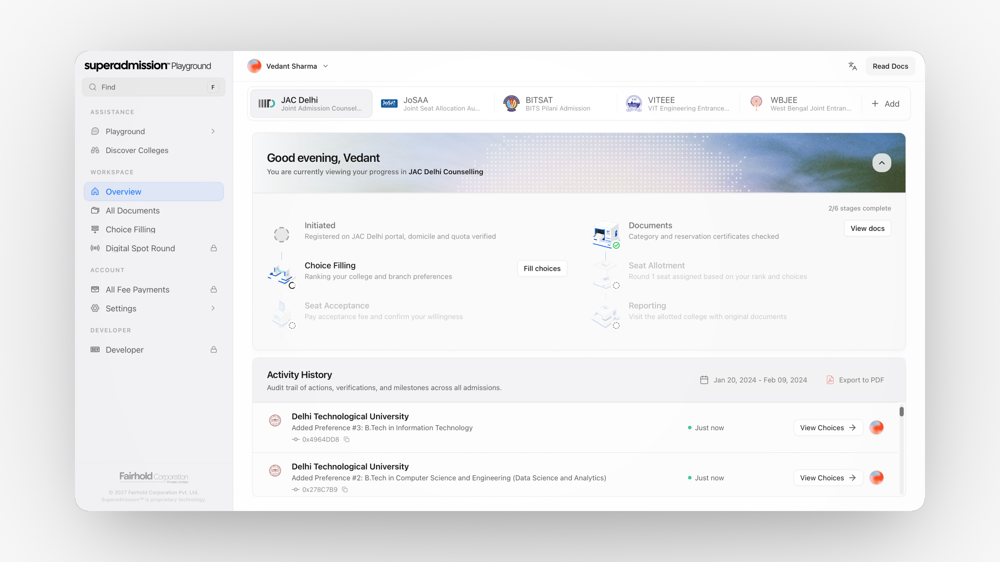

export const HomeLink = ({ href, icon, children }) => (
  <a className="sm-home-link" href={href}>
    <Icon icon={icon} size={12} />
    {children}
  </a>
)

export const PathCard = ({ title, description, href, image, children }) => (
  

    
    

      <a className="sm-home-card-title" href={href}>{title}</a>
      
{description}

      
{children}

    

  

)

export const ListCard = ({ title, children }) => (
  

    

      
{title}

      
{children}

    

  

)

export const HeroPanel = () => (
  

    
  

);

  <section className="sm-home-hero">
    

      <h1 className="sm-home-title sm-home-title-split">
        One platform for the world’s largest admission ecosystem.
      </h1>

      

        Superadmission brings India's diverse admission pathways into one place. From discovering colleges and understanding eligibility to navigating counselling and securing a seat, we are making the journey to higher education simpler.
      

      

        <a href="/understanding-admissions/how-admissions-in-india-actually-work" className="sm-home-btn sm-home-btn-primary">Start reading</a>
        <a href="/superadmission/what-is-superadmission" className="sm-home-btn sm-home-btn-secondary">What is Superadmission</a>
      

    

    

      <HeroPanel />
    

  </section>

  <section className="sm-home-section">
    
Start here

    <h2 className="sm-home-heading">Choose where to begin</h2>
    
Pick the path that fits what you need to understand first.

    

      <PathCard title="Understanding Admissions" description="How admissions in India work today, and why the current system is hard to run." href="/understanding-admissions/how-admissions-in-india-actually-work" image="/images/understanding.png">
        <HomeLink href="/understanding-admissions/how-admissions-in-india-actually-work" icon="graduation-cap">How admissions in India actually work</HomeLink>
        <HomeLink href="/understanding-admissions/what-is-counselling" icon="git-branch">What is counselling</HomeLink>
        <HomeLink href="/understanding-admissions/education-policy-and-digital-india" icon="landmark">Education policy and digital India</HomeLink>
      </PathCard>

      <PathCard title="Superadmission" description="The vision, the platform, and how institutions and authorities use it." href="/superadmission/what-is-superadmission" image="/images/superadmission.png">
        <HomeLink href="/superadmission/what-is-superadmission" icon="book-open">What is Superadmission</HomeLink>
        <HomeLink href="/superadmission/dashboard" icon="layers">Dashboard</HomeLink>
        <HomeLink href="/superadmission/praveshai" icon="clipboard-check">Pravesh AI</HomeLink>
      </PathCard>

      <PathCard title="FAQs" description="Straight answers, written for each group of people involved." href="/faqs/general-faqs" image="/images/faq.png">
        <HomeLink href="/faqs/for-students" icon="message-circle">For students</HomeLink>
        <HomeLink href="/faqs/for-parents" icon="user-round">For parents</HomeLink>
        <HomeLink href="/faqs/for-counselling-authorities" icon="landmark">For counselling authorities</HomeLink>
      </PathCard>
    

  </section>

  <section className="sm-home-section">
    
More

    <h2 className="sm-home-heading">Stay updated</h2>
    
Follow admission news, policy reforms and exam updates.

    

      <ListCard title="News Stand">
        <HomeLink href="/newsstand" icon="newspaper">Latest admission updates</HomeLink>
        <HomeLink href="/newsstand" icon="landmark">Policy reforms</HomeLink>
        <HomeLink href="/newsstand" icon="clipboard-check">Exam news</HomeLink>
      </ListCard>
    

  </section>

