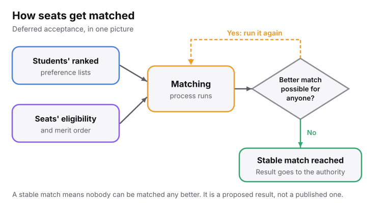
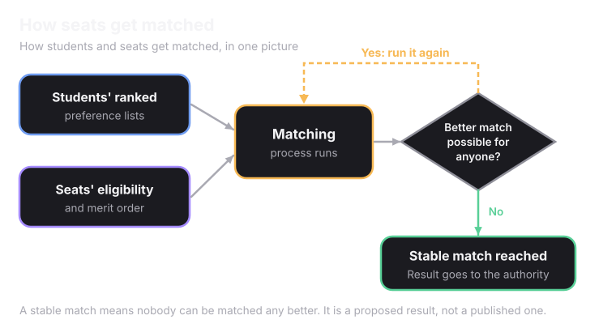

<Frame caption="A stable match means nobody can be matched any better.">
  
  
</Frame>

## How it works

<Steps>
  <Step title="Every student has a ranked list" icon="list-ordered">
    The seats they would accept, in order.
  </Step>
  <Step title="Every seat has a ranked list" icon="trophy">
    The students it would accept, by merit and eligibility.
  </Step>
  <Step title="Students match to their best available option" icon="shuffle">
    The match is provisional.
  </Step>
  <Step title="A better rank can take a seat" icon="arrow-up">
    If someone with a better rank wants the same seat, they can take it. The student they replace moves to their next preference.
  </Step>
  <Step title="It repeats until nobody can do better" icon="check">
    That point is called a stable match.
  </Step>
</Steps>

New to the idea? Try the 3-student example on [What is Counselling?](/understanding-admissions/what-is-counselling).

## Reservation is built in

<Tip>
Category and reservation rules are not applied afterwards. They are built into each seat's eligibility from the start. A reserved seat simply never appears as an option for a student outside that category.
</Tip>

<CardGroup cols={2}>
  <Card title="Over a million" icon="gauge">
    This approach can process well over a million applications in under an hour.
  </Card>
  <Card title="Approval from authority" icon="file-check">
    What comes out goes to the authority for review. Nothing reaches a student until the authority signs off.
  </Card>
</CardGroup>

<Card title="How an authority runs a round" icon="landmark" href="/superadmission/how-counselling-authorities-use-superadmission" horizontal>
  Review, authorise, publish.
</Card>
