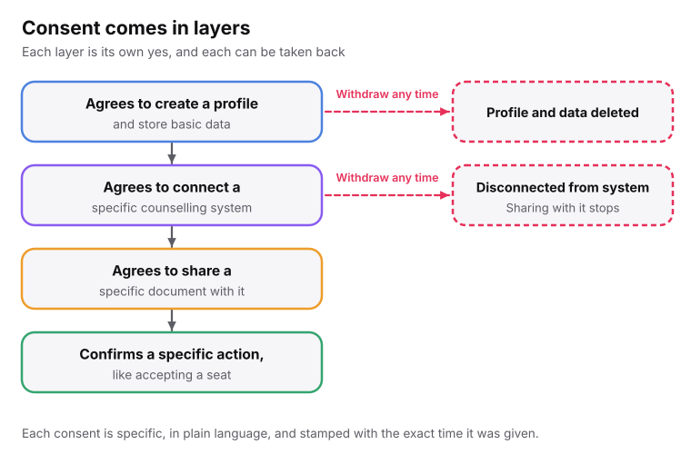
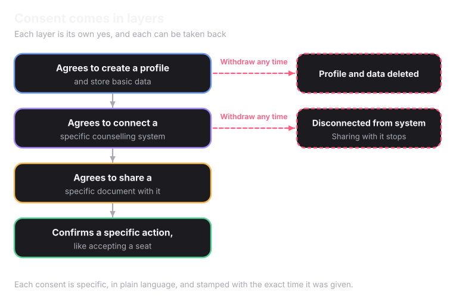

A student's data is **theirs**. Superadmission may use it only in the ways the student has agreed to, one at a time.

## Consent comes in layers

<Frame caption="Each consent is its own yes, and each can be taken back without touching the others.">
  
  
</Frame>

<Tip>
Agreeing to have a profile is not agreeing to share a document with JoSAA. Agreeing to share with JoSAA is not agreeing to accept a seat.
</Tip>

## What every consent looks like

<CardGroup cols={2}>
  <Card title="Specific" icon="target">
    It names the one thing the student is agreeing to.
  </Card>
  <Card title="Plain language" icon="message-square-text">
    Written simply, not in legal wording.
  </Card>
  <Card title="Available in more than one Indian language" icon="languages">
    A portal that works only in English is a real barrier for many applicants.
  </Card>
  <Card title="Time-stamped" icon="clock">
    Stamped with the exact time it was given.
  </Card>
</CardGroup>

## What a student controls

<CardGroup cols={2}>
  <Card title="Which systems to connect" icon="link">
    Connecting JoSAA does not connect a state CET.
  </Card>
  <Card title="Which documents to share" icon="files">
    A document verified once is not shared with every system automatically.
  </Card>
  <Card title="Edits before locking" icon="pencil">
    Anything entered can be changed freely until it is locked in.
  </Card>
  <Card title="Confirming real actions" icon="badge-check">
    Nothing that affects a real outcome happens until the student confirms it.
  </Card>
</CardGroup>

## A student's rights

<AccordionGroup>
  <Accordion title="See everything held about you" icon="eye">
    A student can see all the data held about them, and their own complete history of actions.
  </Accordion>
  <Accordion title="Ask for a correction" icon="pencil">
    If something is wrong, a student can ask for it to be fixed.
  </Accordion>
  <Accordion title="Ask for deletion" icon="trash-2">
    Once a student asks, the data is gone from active systems within 30 days.
  </Accordion>
  <Accordion title="Take a consent back" icon="undo-2">
    Withdrawing a profile consent deletes the profile and data. Withdrawing a connection consent disconnects that system and stops sharing with it. Neither touches the other consents.
  </Accordion>
</AccordionGroup>

<Note>
A grievance officer handles these requests within a set time. How long records are kept is on [How Superadmission Handles Student Data](/superadmission/how-superadmission-handles-student-data).
</Note>

<Card title="Next: Security and Privacy" icon="lock" href="/superadmission/security-and-privacy" horizontal>
  How the data is protected.
</Card>
