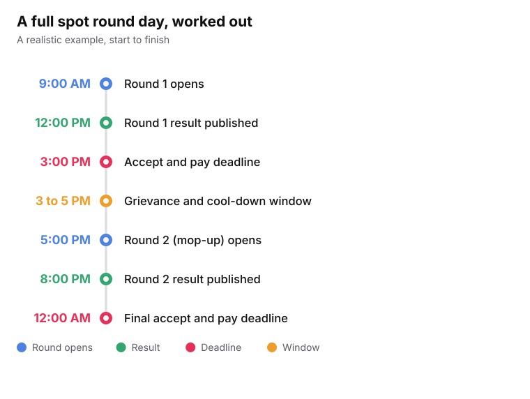
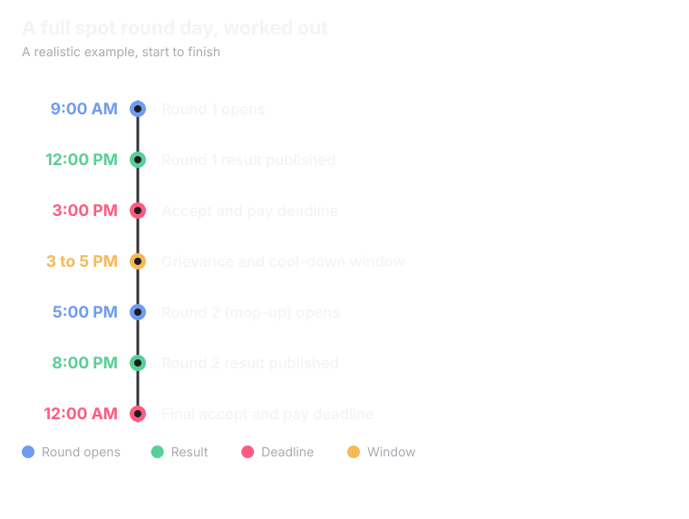

<Info>
A **spot round** is a final, fast round run after the regular rounds close. Its job is to fill seats that are still empty.
</Info>

## How spot rounds run today

<CardGroup cols={3}>
  <Card title="State bodies" icon="map-pin">
    JAC for engineering, state medical and architecture portals, and most others, run their spot rounds in person. Students show up physically.
  </Card>
  <Card title="JoSAA" icon="cpu">
    Does not run its own spot round. Leftover seats go to CSAB, which runs a separate process for them.
  </Card>
  <Card title="MCC" icon="stethoscope">
    Runs its spot round online, directly. No one needs to be present.
  </Card>
</CardGroup>

<Note>
Seats still empty after all of this go to the individual institutes. They can handle them in their own way. That part does not change.
</Note>

## What changes in the digital version

The core idea is simple: let every counselling body run this online, not just the two or three that can today. Four things change.

<CardGroup cols={2}>
  <Card title="Results in hours, not days" icon="zap">
    A regular round can take days to publish a result. A digital spot round is built to return one in 3 hours or less.
  </Card>
  <Card title="No documents to verify on the spot" icon="file-check">
    Physical spot rounds verify documents on the spot because there is no other way. Here, documents are already verified in the vault.
  </Card>
  <Card title="A short, fixed window to accept and pay" icon="hourglass">
    After a result, a student gets roughly 2 to 3 hours to accept the seat and pay. It keeps the speed of paying on the spot.
  </Card>
  <Card title="PraveshAI tells a student to show up" icon="bell">
    A student who has no seat yet, and has a real chance in, say, a CSAB spot round, gets a direct notification. PraveshAI then guides them through every deadline.
  </Card>
</CardGroup>

<Tip>
In a physical spot round, a student has to already know it is happening and be there. A notification removes that gap.
</Tip>

## A full day, worked out

More than one spot round can run in a single day, because the whole process is automated. This example assumes the leftover seat matrix was published a day or two earlier, so students have already filled their choices.

<Frame caption="Two full mop-up rounds inside one day.">
  
  
</Frame>

<Info>
The whole digital spot round process is built to need no more than a single day.
</Info>

<Note>
Whatever seats are still empty after this go to the university directly, the same as today.
</Note>

<Card title="Next: Unified Profile and Documents" icon="user-check" href="/superadmission/unified-profile-and-documents" horizontal>
  Why documents do not need checking again on the spot.
</Card>
