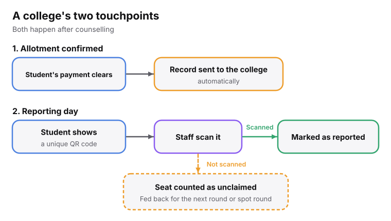
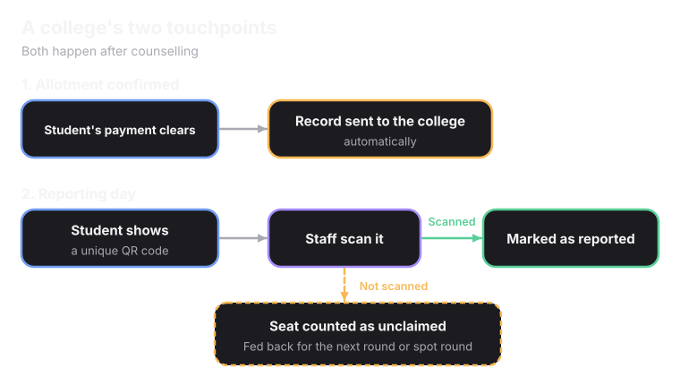
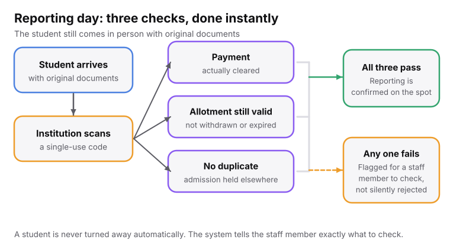
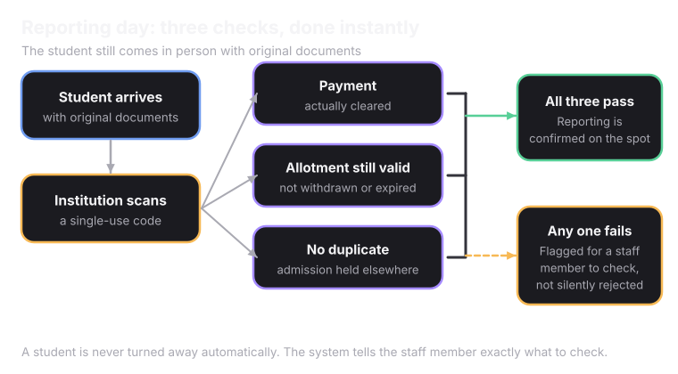

Colleges interact with Superadmission only in the later stages of admission, after counselling.

<Frame caption="A college's two points of interaction, both after counselling.">
  
  
</Frame>

## Allotment confirmed

The first point of interaction is when an allotment is confirmed. When a student's payment clears for a seat at the college, a record is sent to the college automatically. It includes:

- The student's identity and other personal information, already verified.
- The program and the round of counselling in which the seat was allotted.
- The document status, which shows whether all documents are verified.
- The documents the student used, such as Aadhaar, APAAR or another form of identity.
- The payment confirmation, which is proof that the seat payment has cleared.

## Reporting day

The second point of interaction is reporting day, when the student reports to the college in person. Each student gets a unique QR code that contains all their information and the required sign-in remarks. To mark a student as reported, college staff only need to scan the QR code.

<Frame>
  
  
</Frame>

## When a student does not report

The college does not have to track this manually or pass the information to the platform or the counselling authority. If a QR code stays unscanned, the seat is automatically treated as unclaimed and fed back into the system for the next round or the spot round.

<Info>
The admission office does not have to keep track of unclaimed seats by hand.
</Info>
