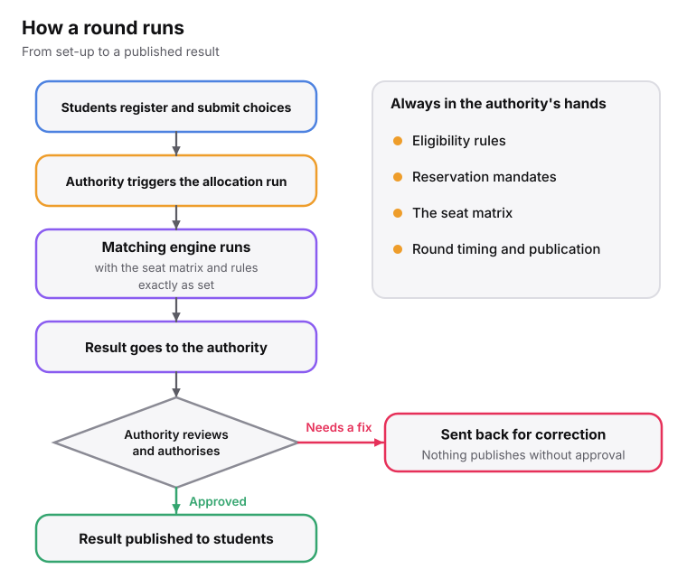
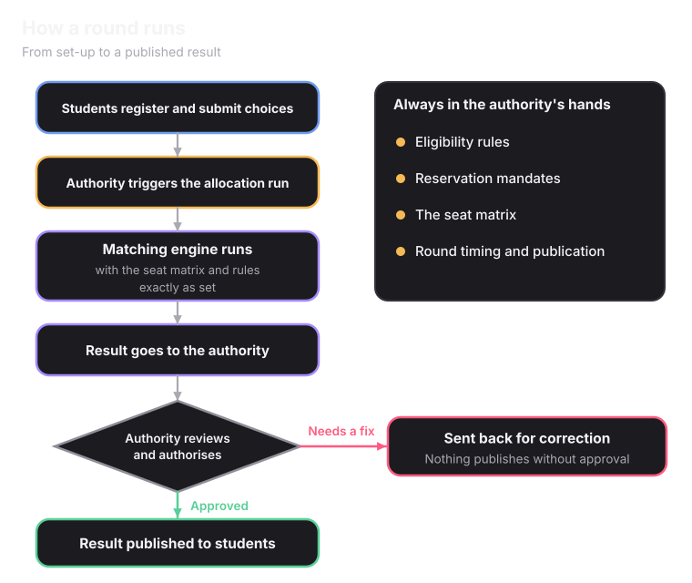

## Where the time goes today

Seat matching is mechanical. Ranks go in, seats come out, using rules the authority already set. The time goes into everything around it.

<CardGroup cols={3}>
  <Card title="Re-checking documents" icon="files">
    Verifying documents another system may have already checked.
  </Card>
  <Card title="Chasing stalled students" icon="user-x">
    Students who stopped halfway through a step.
  </Card>
  <Card title="Answering grievances" icon="message-square-warning">
    Many trace back to unclear communication, not a wrong outcome.
  </Card>
</CardGroup>

## What changes day to day with Superadmission

<CardGroup cols={3}>
  <Card title="Less manual work" icon="check-check">
    Far fewer documents to verify from scratch.
  </Card>
  <Card title="Fewer disputes" icon="handshake">
    The system removes much of the confusion that causes student errors and an assisted  grievance management system is being created to handle and sort grievances 
  </Card>
  <Card title="Real-time updates" icon="activity">
    A live view of how the round is going is provided along with actions to stop/pause a round.
  </Card>
</CardGroup>

## How a round runs

<Frame caption="Nothing publishes without the authority's approval.">
  
  
</Frame>

## The verification queue

Documents are scored and sorted before they reach a person. Most clear automatically. Only genuinely uncertain ones are surfaced, and each comes flagged with what looks off. So reviewers do not start from a blank page.

See how the score works on [Unified Profile and Documents](/superadmission/unified-profile-and-documents).

<CardGroup cols={2}>
  <Card title="Managing admissions" icon="sliders-horizontal" href="/superadmission/managing-admissions">
    Set up a round, and use the safety levers when something changes.
  </Card>
  <Card title="Monitoring admissions" icon="activity" href="/superadmission/monitoring-admissions">
    The live view, alerts and round-to-round comparison.
  </Card>
</CardGroup>
