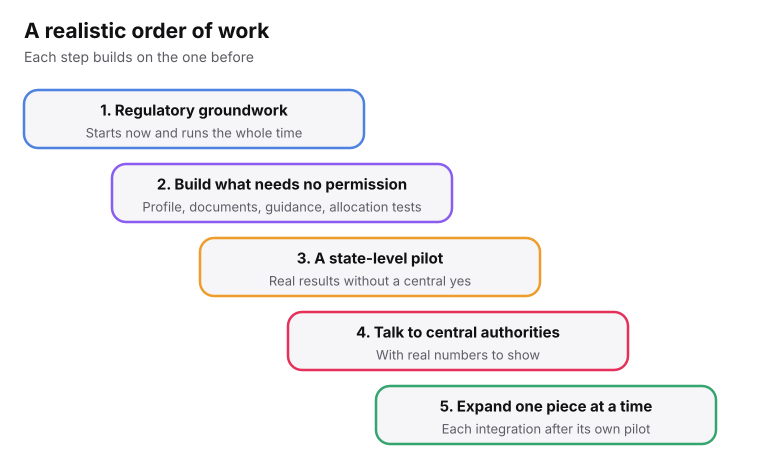
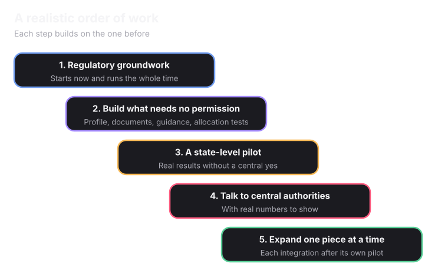

Counselling authorities like JoSAA and MCC operate under strict government mandates. Integrating Superadmission into their ecosystem relies entirely on proving our platform's absolute compliance, security, and systemic value. Their adoption is a milestone we actively seek through operational excellence.

## For counselling authorities

<Steps>
  <Step title="Show clear benefits" icon="trending-up">
    Less document re-verification, fewer grievances, and real-time visibility into their own round. Made specific to their situation.
  </Step>
  <Step title="Meet technical standards" icon="shield-check">
    The technical team, usually the <Tooltip tip="The National Informatics Centre runs much of the Government of India's technology.">National Informatics Centre (NIC)</Tooltip> or another government body, reviews data flows, system access points and security.
  </Step>
  <Step title="Get ministry clearance" icon="landmark">
    For a central authority, this almost certainly needs sign-off from the relevant ministries. That has its own timeline.
  </Step>
</Steps>

## For colleges

<CardGroup cols={2}>
  <Card title="Start with a web view" icon="monitor">
    No integration needed. Confirmed allotments and reporting-day checks are handled on a web page.
  </Card>
  <Card title="Move to an API later" icon="plug">
    Confirmed allotments flow into the college's own student database. Nothing already set up is lost.
  </Card>
</CardGroup>

Details are on [How Colleges Use Superadmission](/superadmission/how-colleges-use-superadmission).

Pre-verified documents only save real time if a college is willing to trust "Verified by Superadmission" instead of re-checking. That cannot be assumed. In some cases it may need regulatory confirmation that accepting it this way is allowed. It has to be shown, probably starting with colleges that already work digitally.

## A realistic order of work

<Frame caption="If everything goes right.">
  
  
</Frame>

<Card title="What it plugs into" icon="plug" href="/superadmission/digital-infrastructure-and-integrations" horizontal>
  Approvals and dependencies in detail.
</Card>
