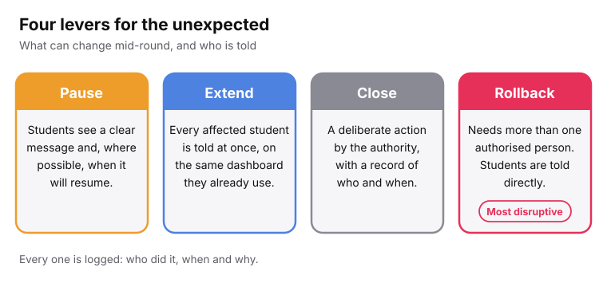
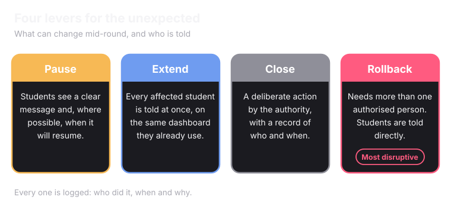
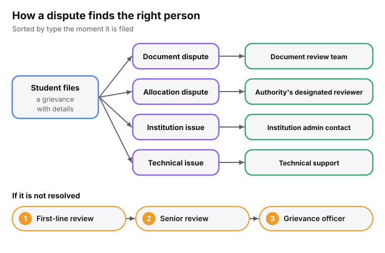
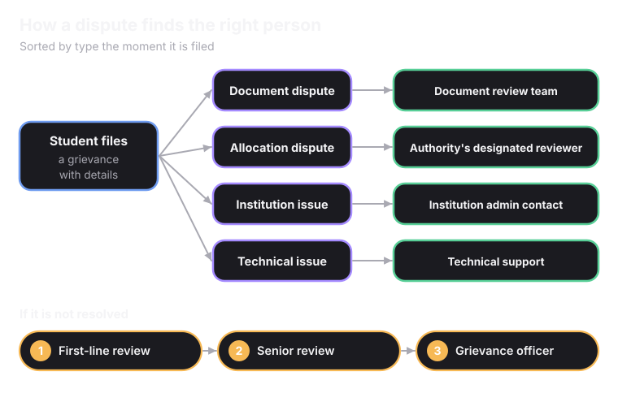

<Info>
Everything on this page stays with the authority. Superadmission applies the authority's choices exactly as set.
</Info>

## Setting up a round

<Steps>
  <Step title="Configure the seat matrix" icon="grid-3x3">
    How many seats exist, split by programme, category and any special quotas. This comes directly from the authority. Nothing is inferred or estimated.
  </Step>
  <Step title="Set eligibility rules" icon="list-checks">
    Minimum rank or percentile cutoffs, domicile requirements and any exam-specific conditions. Entered once, then applied consistently every round.
  </Step>
  <Step title="Set the round structure" icon="route">
    How many rounds, each round's deadlines, and how choices carry forward or drop between rounds.
  </Step>
</Steps>

## What stays in the authority's hands

<CardGroup cols={2}>
  <Card title="Eligibility rules" icon="list-checks">
    Applied exactly as configured. Never adjusted automatically.
  </Card>
  <Card title="Reservation mandates" icon="scale">
    Category percentages and quotas are the authority's own policy, not a default the system supplies.
  </Card>
  <Card title="The seat matrix" icon="grid-3x3">
    Entered and updated only by the authority.
  </Card>
  <Card title="Round timing and publication" icon="clock">
    When a round opens, closes, and when a result goes live all need the authority's action.
  </Card>
</CardGroup>

## When something has to change mid-round

<Frame caption="Every one is logged: who did it, when and why.">
  
  
</Frame>

<CardGroup cols={2}>
  <Card title="Pause" icon="pause">
    For a technical failure, a legal order, or a sudden spike in grievances. Students see a clear message, not a frozen dashboard.
  </Card>
  <Card title="Extend" icon="calendar-plus">
    Every affected student is told at once, on the same dashboard that showed them the old deadline.
  </Card>
  <Card title="Close" icon="circle-check">
    On schedule or early. It is a deliberate action by the authority, with a record of who ended it and when.
  </Card>
  <Card title="Rollback" icon="undo-2">
    The most disruptive action. It needs more than one authorised person and a documented reason. Affected students are told directly.
  </Card>
</CardGroup>

<Warning>
Rollback is hard to trigger on purpose. Students may already have accepted a seat or told their family. One person acting alone is a bigger risk than the delay of a second signature.
</Warning>

## When a student disagrees

<Frame caption="Each level has its own timeline, and the student can see where their grievance sits.">
  
  
</Frame>

<Accordion title="What counts as a grievance" icon="info">
  A **document dispute**: a document was rejected and the student thinks it is valid. An **allocation dispute**: an allotment does not seem to match the rules. An **institution-level issue**: something went wrong at reporting. A **technical issue**: the dashboard showed something wrong, or a deadline notification did not arrive.
</Accordion>

<Info>
The final internal step is the authority's grievance officer. DPDP already requires every data fiduciary to have one for data-related complaints. The same role, or an equivalent one, handles admission disputes.
</Info>

<Card title="Next: Monitoring Admissions" icon="activity" href="/superadmission/monitoring-admissions" horizontal>
  Seeing a round while it is still open.
</Card>
