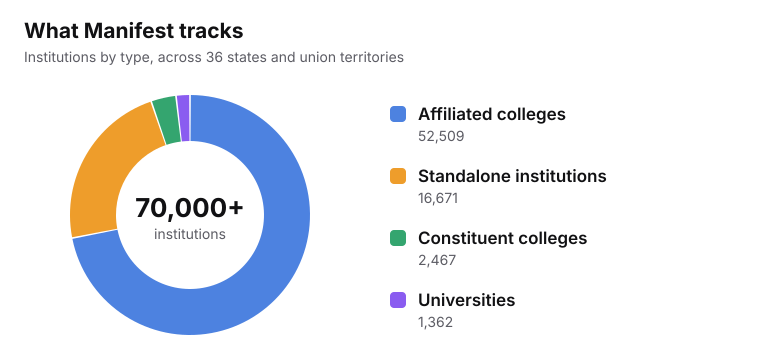
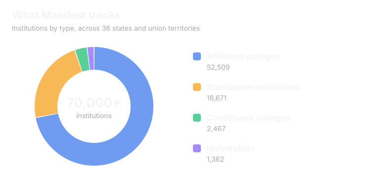

Manifest is a repository of every degree-granting higher education institution in India. It is the data layer under Superadmission.

<Frame caption="Counts as described on the live Manifest page.">
  
  
</Frame>

<CardGroup cols={3}>
  <Card title="70,000+" icon="school">
    institutions across 36 states and union territories
  </Card>
  <Card title="49,071" icon="sparkles">
    already carry enriched profile data
  </Card>
  <Card title="80+" icon="list-checks">
    fields tracked for each institution
  </Card>
</CardGroup>

## The problem it solves

<CardGroup cols={2}>
  <Card title="Visibility is usually sold" icon="megaphone">
    Most discovery sites rank whoever pays the most and not whoever performs best.
  </Card>
  <Card title="Government data is not present neatly" icon="unplug">
    The data exists across AISHE, NIRF, NAAC, UGC and AICTE. It sits in five formats with no shared key.
  </Card>
  <Card title="Fake institutions are not flagged" icon="triangle-alert">
    There is no clear signal at the moment a student decides whether a college is even real.
  </Card>
  <Card title="Reservation data hides in PDFs" icon="file-text">
    Quota details often surface mid-cycle, in documents that assume knowledge first-generation applicants may not have.
  </Card>
</CardGroup>

## How it stays neutral

<Info>
The design borrows an idea from UPI and ONDC: shared infrastructure.
</Info>

<CardGroup cols={2}>
  <Card title="No paid placement" icon="ban">
    Rankings come from a government metric or a clearly disclosed method. Manifest does not charge institutions to be listed or ranked.
  </Card>
  <Card title="Open data" icon="globe">
    The data is exposed through a public API, so anyone can view it.
  </Card>
  <Card title="Bad news is shown plainly" icon="shield-alert">
    A weak or negative UGC or AICTE recognition status is shown as prominently as the institution's name.
  </Card>
  <Card title="Checkable against the source" icon="badge-check">
    Every institution is keyed to its AISHE code, the government's own identifier. That stops duplicates.
  </Card>
</CardGroup>

## What is tracked for each institution

<CardGroup cols={3}>
  <Card title="Who and where" icon="map-pin">
    Identity, location and contact details. Mostly from AISHE. Contact details come from web enrichment.
  </Card>
  <Card title="How good is it" icon="award">
    NIRF rank across nine categories, NAAC grade and CGPA, NBA accreditation and approval status.
  </Card>
  <Card title="What to expect" icon="graduation-cap">
    Placements, infrastructure, programs and general content like photos and campus life.
  </Card>
</CardGroup>

<Accordion title="The 14 areas of a full profile" icon="list">
  Overview, admissions, courses and fees, cutoffs, placements, faculty, infrastructure, hostels, scholarships, rankings, recognition, a photo gallery, contact details and FAQs.
</Accordion>

<Accordion title="Cutoffs and fees go down to the course" icon="indian-rupee">
  Cutoffs are broken down by course, year, category and quota. Fees are tracked per course, because two programs at the same college can cost very differently. PraveshAI reads this data first when it estimates a student's chances.
</Accordion>

<Note>
A blank field means the fact has not been verified yet. It does not mean the institution does not have it. Every record shows how complete it is and when it was last checked.
</Note>

## Finding and comparing a college

<CardGroup cols={2}>
  <Card title="Search without an account" icon="search">
    By name, city, state, program or entrance exam. Narrow with filters like location, discipline, ownership, ranking, accreditation, fees and placements.
  </Card>
  <Card title="Compare up to three" icon="columns-3">
    Side by side across rankings, fees, placements, courses, faculty, infrastructure and scholarships. Export as a PDF or share as a link.
  </Card>
</CardGroup>

## Where the data comes from

Institutions data is sourced from AISHE's own dataset. NIRF rankings and a hand-verified set of top institutions are layered on top. Whatever government data does not cover is read from the institution's own website.

<Warning>
**Verified** here means a fact traces back to a government source or a clearly disclosed method. It does not mean a person checked every field by hand.
</Warning>

<Card title="Next: Digital Spot Round Environment" icon="timer" href="/superadmission/digital-spot-round-environment" horizontal>
  See how leftover seats get filled in a single day.
</Card>
