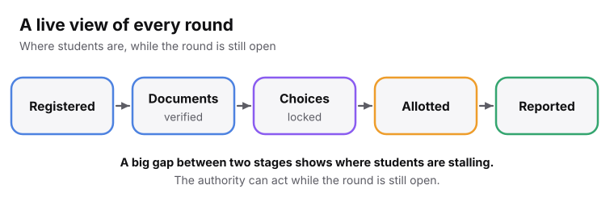
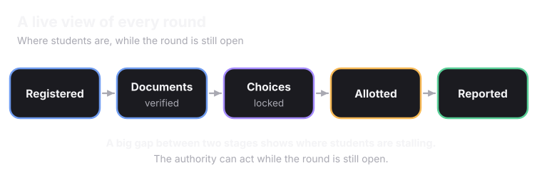
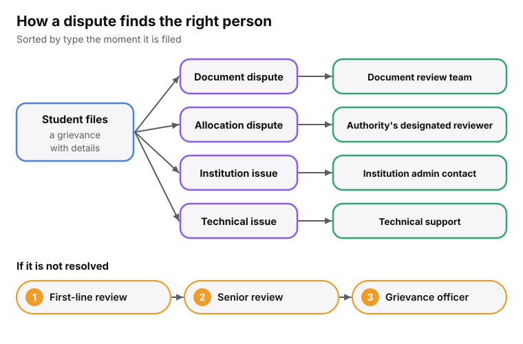
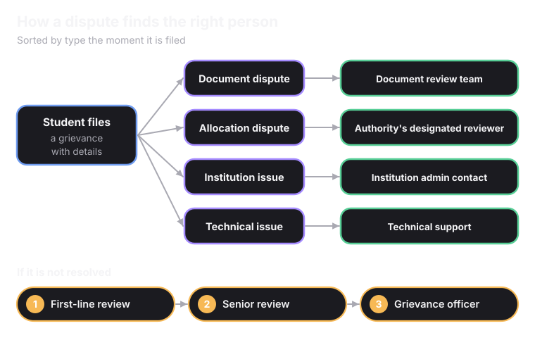

## A live view of the round

<Frame>
  
  
</Frame>

## Seat fill, by category and institute

The authority sees how seats are filling in real time, by category and by institute. That makes it possible to notice mid-round that one category or one institute is under-filling. Without it, the problem shows up after the round closes and the options for fixing it are fewer.

## Alerts when something needs attention

<CardGroup cols={3}>
  <Card title="An allocation run fails" icon="octagon-alert">
    The authority is alerted within roughly 60 seconds.
  </Card>
  <Card title="The verification queue backs up" icon="inbox">
    Flagged before it becomes a bottleneck at the deadline.
  </Card>
  <Card title="A deadline nears with a large gap" icon="calendar-clock">
    If many registered students have not locked choices yet, the authority sees it ahead of time.
  </Card>
</CardGroup>

## This round against the last one

Every round leaves the same kind of data: how long verification took, how many grievances came in, and how close the fill rate got to full. Seeing this round next to the last one shows whether a change helped, like moving a deadline or adding reviewers.

## When a student disagrees

<Frame caption="Each level has its own timeline, and the student can see where their grievance sits.">
  
  
</Frame>

<Accordion title="What counts as a grievance" icon="info">
  A **document dispute**: a document was rejected and the student thinks it is valid. An **allocation dispute**: an allotment does not seem to match the rules. An **institution-level issue**: something went wrong at reporting. A **technical issue**: the dashboard showed something wrong, or a deadline notification did not arrive.
</Accordion>

## Everything leaves a record

<Accordion title="What is recorded" icon="file-clock">
  Every meaningful action: a document cleared, a list locked, a result authorised. Each record says what happened, who or what triggered it, and when. For automated decisions, the inputs are kept too, like the cutoffs used or the score a document got.
</Accordion>

<Accordion title="Who can see what" icon="eye">
  A student sees their own history. An authority sees the actions within its own process. A designated compliance officer can see the full log if something needs investigating.
</Accordion>

<Card title="Next: How Superadmission Handles Student Data" icon="shield-check" href="/superadmission/how-superadmission-handles-student-data" horizontal>
  The laws behind everything a student shares.
</Card>
