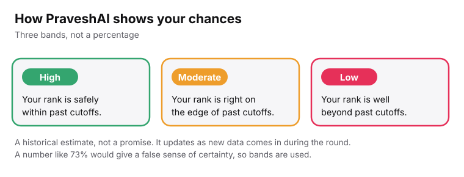
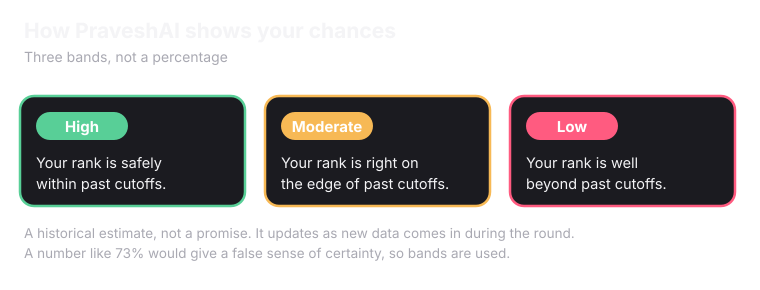

PraveshAI is the thinking and guidance layer of Superadmission. Its sole purpose is to give every student verified and correct guidance at the right time, so they do not have to rely on paid counsellors, word of mouth, unverified resources.

## Real-time guidance

Students can ask PraveshAI questions about a specific college or personalised guidance.

<CardGroup cols={2}>
  <Card title="Factual questions" icon="database" href="/superadmission/manifest">
    "What is the fee for computer science at this college?" The answer comes from [Manifest](/superadmission/manifest). It traces back to a government source or a disclosed method. If the data is incomplete, the chatbot says so instead of guessing.
  </Card>

  <Card title="Personal questions" icon="user">
    "Which of these is better for me?" It uses only what is present on student's profile(Rank, Category etc.), or shared in the chat(such as desired course). It explains why an option fits. 
  </Card>
</CardGroup>

## Help with choice filling

One of PraveshAI's key roles is assisting during choice filling. While a student fills in choices, a tag appears next to each choice they add to their preference list. The tags are **Low**, **Mid** and **High**. They show the student's chances of securing that program or seat.

<Frame caption="The tags shown next to each choice.">
  
  
</Frame>

<Note>
  The tags are tiers instead of numbers like 73%, because numbers give a false sense of certainty. The tiers are based on historical estimates, such as previous year cutoffs and rank trends.
</Note>

## Help with the next step

PraveshAI also helps a student work out what to do next.

<Tabs>
  <Tab title="During counselling">
    - Whether to <Tooltip tip="Float means you keep this seat for now, and can be moved to a better choice on your list in a later round.">float</Tooltip>, <Tooltip tip="Freeze means you accept the seat and stop looking for a better one.">freeze</Tooltip> or accept the seat.
  </Tab>
  <Tab title="After counselling">
    Whether they need to make a fee payment, or withdraw from a seat if they have secured more than one. This saves students money. It also nudges students to vacate seats, so fewer seats stay vacant after counselling.
  </Tab>
</Tabs>

## What else PraveshAI can do

- Help a student raise a grievance, and write emails and grievance reports on their behalf.
- Edit the student's calendar and sync it to Google Calendar.
- Set up smart alerts in advance such as which deadline is coming up and requires instant action.
- Make a demo choice list.
- Apply that choice list to the actual choice filling or preference tab, once the student gives permission with their security PIN.
