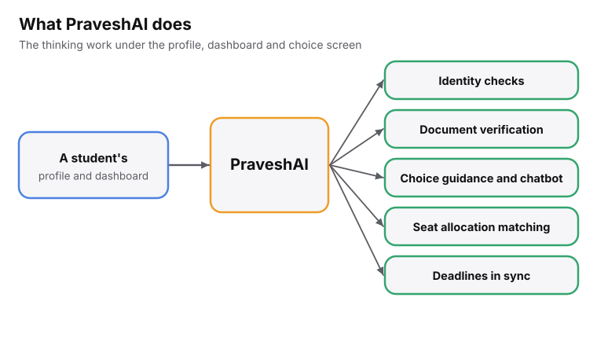
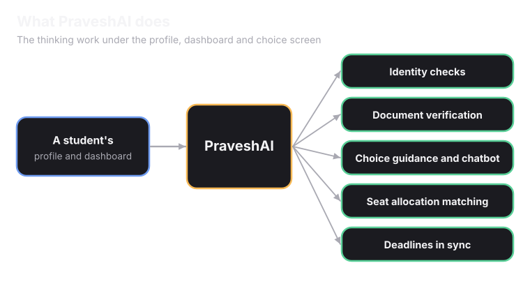
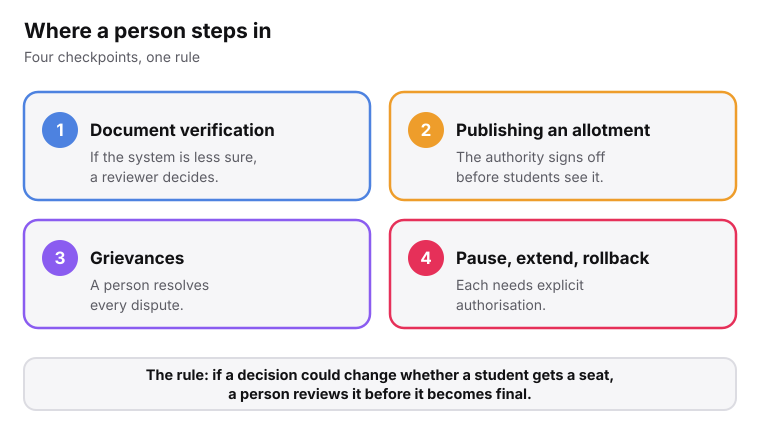
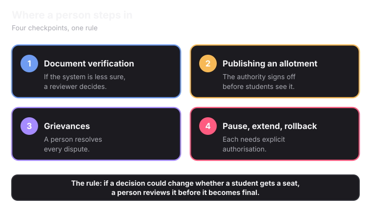

<Info>
PraveshAI is **not a separate product** a student signs up for. It is the part of Superadmission that does the thinking work underneath the profile, the dashboard and the choice-filling screen.
</Info>

<Frame caption="Everything that happens automatically in Superadmission is done by PraveshAI.">
  
  
</Frame>

## What it does

<CardGroup cols={2}>
  <Card title="Identity and profile" icon="user-check" href="/superadmission/unified-profile-and-documents">
    Verifies who a student is once. That one profile is what every connected counselling system reads.
  </Card>
  <Card title="Document workflows" icon="file-check" href="/superadmission/unified-profile-and-documents">
    Checks documents, pulls what it can from DigiLocker, and sends anything uncertain to a person.
  </Card>
  <Card title="Guidance and support" icon="lightbulb">
    Shows realistic chances for each choice, based on rank, category and real past cutoffs.
  </Card>
  <Card title="Smart alerts" icon="bell" href="/superadmission/unified-dashboard">
    Watches every deadline across every connected system. Warns a student before two deadlines collide.
  </Card>
  <Card title="A chatbot on verified data" icon="message-circle">
    Answers factual questions from Manifest's registry. Answers personal questions using only what the student shared.
  </Card>
  <Card title="Seat matching" icon="shuffle" href="/superadmission/counselling-and-seat-allocation">
    Proposes who gets which seat. The authority reviews it before anything is published.
  </Card>
</CardGroup>

## How chances are shown

<Frame caption="Chances are based on past cutoffs.">
  
  
</Frame>

<Warning>
This is a historical estimate. A rank that cleared a cutoff last year may not clear it this year. Demand and seat counts change every cycle.
</Warning>

<Tip>
PraveshAI never changes, reorders or locks in a student's list. It gives data-backed guidance. The student decides.
</Tip>

## The chatbot, two kinds of questions

<CardGroup cols={2}>
  <Card title="Factual questions" icon="database" href="/superadmission/manifest">
    "What is the fee for computer science at this college?" The answer comes from Manifest. It traces back to a government source or a disclosed method. If the data is incomplete, the chatbot says so instead of guessing.
  </Card>
  <Card title="Personal questions" icon="user">
    "Which of these is better for me?" It uses only what the student has added to their profile, or shared in the chat. It explains why an option fits. It does not pick one for them.
  </Card>
</CardGroup>

## Where a person steps in

<Frame caption="If a decision could change whether a student gets a seat, a person reviews it first.">
  
  
</Frame>

<Note>
PraveshAI does not publish an allotment on its own. It does not make a final call on a document it is unsure about. It does not resolve a grievance. A person does each of these.
</Note>

<Card title="Next: Manifest" icon="database" href="/superadmission/manifest" horizontal>
  The data layer PraveshAI reads first.
</Card>
