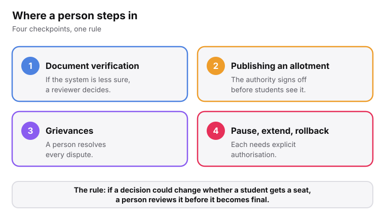
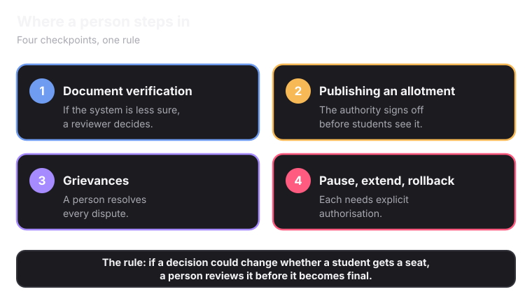

<Info>
Security here is more than a promise. The laws require real protections: encryption, access controls and logs.
</Info>

## How data is protected

<CardGroup cols={2}>
  <Card title="Encrypted" icon="lock-keyhole">
    All student data is encrypted in transit and at rest.
  </Card>
  <Card title="Access controls" icon="shield-check">
    Access is strictly controlled. Category and income documents sit behind stricter controls than a photo or a marksheet.
  </Card>
  <Card title="Stored in India" icon="map-pin">
    A student's data is stored on servers inside India, not sent abroad.
  </Card>
  <Card title="No Aadhaar numbers kept" icon="fingerprint">
    Superadmission never stores Aadhaar numbers or biometric data. Checks happen inside UIDAI's own system. Aadhaar stays optional.
  </Card>
</CardGroup>

## Where a person steps in

<Frame caption="If a decision could change whether a student gets a seat, a person reviews it first.">
  
  
</Frame>

## Every action leaves a record

<Steps>
  <Step title="Something happens" icon="play">
    A document is scored and cleared. A list is locked. An authority authorises a result.
  </Step>
  <Step title="The outcome is recorded" icon="file-check">
    The record says what happened, who or what triggered it, and when.
  </Step>
  <Step title="The reasoning is recorded too" icon="brain">
    For automated decisions, the inputs are kept, like the past-year cutoffs used or the score a document got and why.
  </Step>
  <Step title="The record cannot be edited" icon="lock">
    A correction adds a new record. The original stays as it was.
  </Step>
</Steps>

<Tip>
This is what lets anyone answer why did this happen months later. Without the inputs, all anyone could say is what happened.
</Tip>

## Who can see what

<CardGroup cols={3}>
  <Card title="A student" icon="user">
    Their own complete history: every action on their profile, documents and applications.
  </Card>
  <Card title="An authority" icon="landmark">
    The actions within its own counselling process. Not another authority's records.
  </Card>
  <Card title="A compliance officer" icon="user-check">
    The full log, if something needs investigating. This is the grievance and data-protection officer role DPDP requires.
  </Card>
</CardGroup>

<Note>
Some legal questions are still open, like whether Superadmission counts as a Significant Data Fiduciary. They are listed on [How Superadmission Handles Student Data](/superadmission/how-superadmission-handles-student-data).
</Note>

<Card title="Next: Digital Infrastructure and Integrations" icon="plug" href="/superadmission/digital-infrastructure-and-integrations" horizontal>
  What Superadmission connects to, and what it needs approval for.
</Card>
