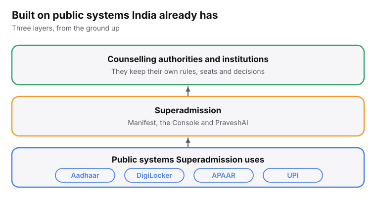
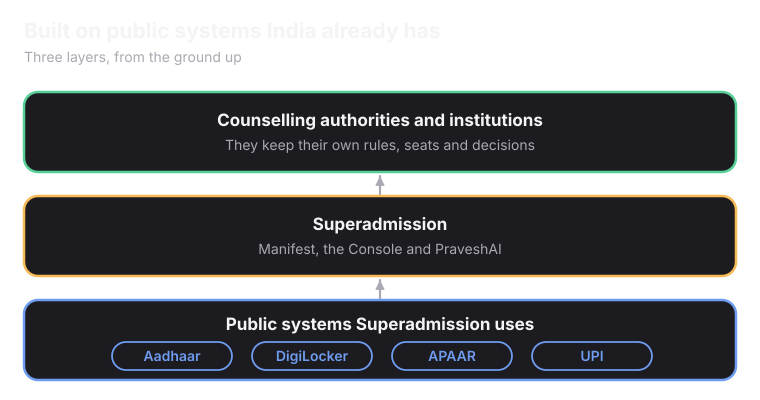

## What "Digital Public Infrastructure" Actually Means

Two things most people have already used without thinking of them this way: paying someone through UPI, and proving your identity with an Aadhaar number. Both are examples of something called Digital Public Infrastructure (DPI).

What makes something DPI, instead of just another app, comes down to three things:

- **Shared system:** <Tooltip tip="UPI (Unified Payments Interface) is a system that lets you transfer money instantly between bank accounts using just your mobile phone.">UPI</Tooltip> isn't a product made by one bank. Every bank, and every payment app, builds on top of the same shared system.
- **It's a set of rules:** DPI defines how systems are allowed to talk to each other, what format data moves in, what gets verified and how. Anyone who follows those rules can build something on top of it.
- Built for everyone: The goal is universal access, a farmer and a bank both use the same UPI rails, not two different systems built for two different budgets.

<Frame caption="Superadmission sits between what India already has and the authorities and institutions that use it.">
  
  
</Frame>

## What it builds on

<CardGroup cols={2}>
  <Card title="Aadhaar" icon="fingerprint">
    Identity is checked with an OTP. Superadmission never stores Aadhaar numbers or biometric data.
  </Card>
  <Card title="DigiLocker" icon="lock">
    Boards and universities place signed copies of certificates here. Superadmission fetches them instead of asking for new uploads.
  </Card>
  <Card title="APAAR" icon="user-check">
    The profile is anchored to the student's APAAR ID, instead of a new ID.
  </Card>
  <Card title="DPDP Act" icon="shield-check">
    India's data protection law sets the rules for how student data can be used.
  </Card>
</CardGroup>

## Ideas borrowed from UPI and ONDC

<CardGroup cols={2}>
  <Card title="Shared, not competing" icon="share-2">
    Manifest is built as shared infrastructure. No institution can pay to change how it appears.
  </Card>
  <Card title="Open data" icon="globe">
    The data behind Manifest is exposed through a public API, so anyone can view it.
  </Card>
</CardGroup>

## Safe and trusted AI

PraveshAI is built to be inspected, not trusted blindly. Every recommendation can be traced back to the data it came from. It fits the focus on safe and trusted AI in the IndiaAI Mission.

<Card title="Read more: PraveshAI" icon="cpu" horizontal href="https://app.mintlify.com/superadmission/superadmission-docs/~/Pravesh-AI-8a7fe68c-ba6e-4c1c-b0c6-e243b06f909d">
  What it can decide, and what it cannot.
</Card>

Read more about DPI and Education Policies on [Education Policy and Digital India](/understanding-admissions/education-policy-and-digital-india).
