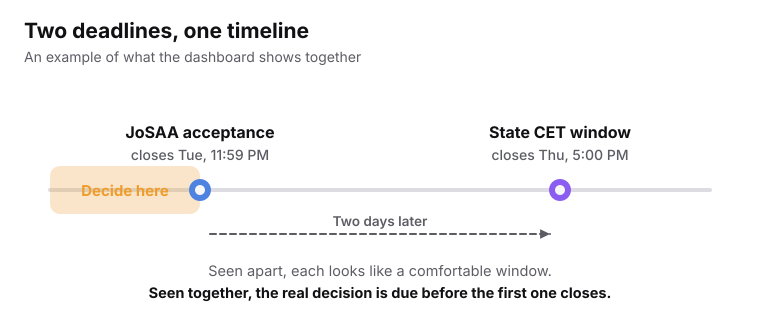
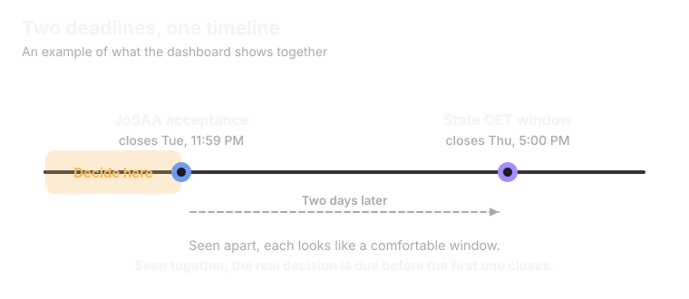
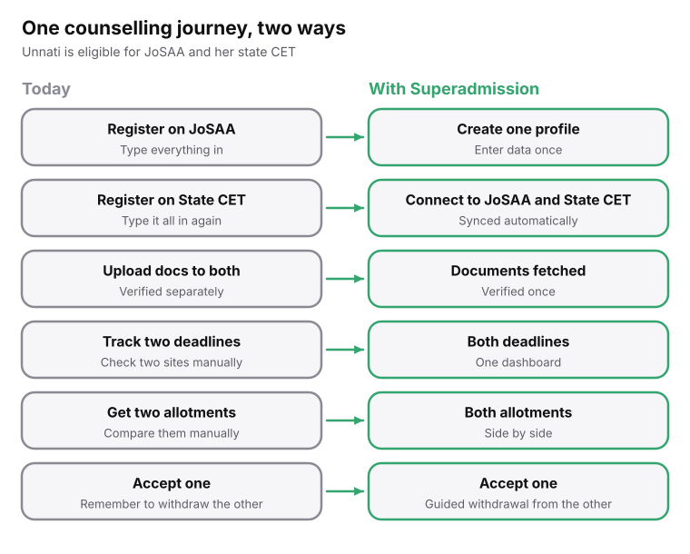
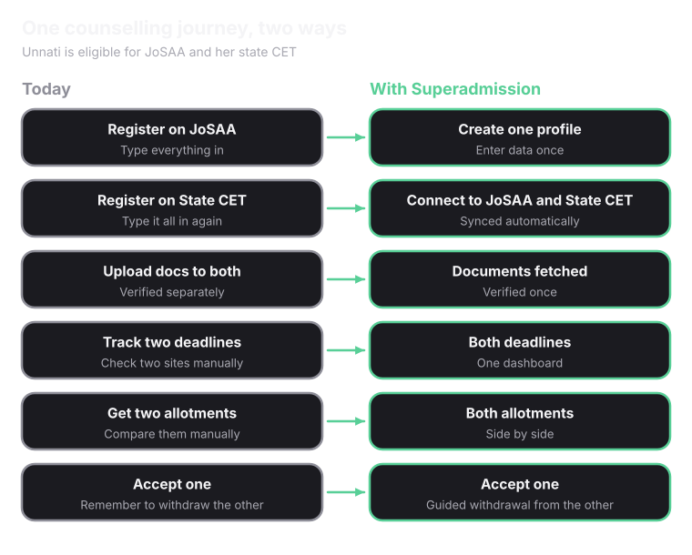

Everything a student does on Superadmission happens in one place.

<Steps>
  <Step title="Create one admission profile" icon="user-plus">
    The student creates a single admission profile using <Tooltip tip="Aadhaar is a 12-digit identity number issued to residents of India.">Aadhaar</Tooltip>, <Tooltip tip="APAAR is the Automated Permanent Academic Account Registry. It is a single academic ID that follows a student through school and every degree after it.">APAAR</Tooltip> and other IDs. Single login and <Tooltip tip="Single sign-on lets you log in once and use the same login across services.">single sign-on</Tooltip> options are available.
  </Step>
  <Step title="Documents are fetched automatically" icon="file-down">
    Mark sheets, scorecards, and identity and category certificates are fetched automatically. Certificates come from <Tooltip tip="DigiLocker is the government's digital document locker. Boards and universities place signed, verified copies of certificates there.">DigiLocker</Tooltip>. For any certificate that is not on DigiLocker, the student uploads it once. This completes profile creation, and this one profile follows the student through the whole admission journey.
  </Step>
  <Step title="Documents are verified once" icon="file-check">
    Each document is verified one time. After that, it is accepted by every participating counselling.
  </Step>
  <Step title="Create a security PIN" icon="lock">
    Along with the profile, the student creates a security PIN. It is used across the platform for actions such as accepting a seat, making a fee payment and locking a choice filling list.
  </Step>
  <Step title="Enter the unified dashboard" icon="layout-dashboard">
    The unified dashboard gives access to every counselling the student is eligible for. They can see and manage all the counselling they choose to take part in, at the same time.
  </Step>
  <Step title="Manage every counselling" icon="list-checks">
    From the dashboard, the student can fill choices, accept seats and pay fees for each counselling. A shared calendar helps them manage several counselling processes at once.
  </Step>
  <Step title="Set alerts and reminders" icon="bell">
    Alerts and personalised reminders can be easily set up, these go to the student's phone number and email, so they do not miss important information.
  </Step>
  <Step title="Get support" icon="life-buoy">
    If anything does not look right, the student can contact support or raise a grievance on the platform itself.
  </Step>
  <Step title="Ask PraveshAI" icon="cpu">
    For any admission-related query, such as the opportunities and options they have, the student can ask PraveshAI. [Read more about PraveshAI](/superadmission/praveshai).
  </Step>
  <Step title="Join digital spot rounds" icon="timer">
    Many counselling bodies currently run spot rounds for leftover seats in person. On Superadmission, students can take part in these digital spot rounds on the platform.
  </Step>
  <Step title="Accept seat and recieve allocation letter + Reporting QR" icon="timer">
    At Last the student can accept seat, pay fees and recieve the allotment letter.This is accompnied by a unique time bound QR code to make their physical reporting at alloted college quick and efficient. Incase of multiple Acceptance, students are reminded before time to withdraw undesired seat.
  </Step>
</Steps>

## The shared calendar

The shared calendar puts the deadlines of different counselling on one timeline. This is done to make sure students don't miss anything and are well prepared for the upcoming counselling rounds and deadlines.

<Frame>
  
  
</Frame>

Students can perform all of these actions without requiring different login IDs, multiple document uploads, or editing and entering their information again and again over different counseling platforms. All of this is available to them on a single dynamic platform that is easy to understand and use, **_available in multiple Indian languages_**, along with accesibility features such as dark mode, contrast variance etc., for a smoother experience.

## One platform instead of many

Students can do all of this without multiple login IDs, repeated document uploads, or entering their information again and again on different counselling platforms. Everything is on one platform that is easy to understand and use. It is available in multiple Indian languages, with extras such as dark mode and contrast variance for a smoother experience.

<Frame caption="One counselling journey, today and on Superadmission.">
  
  
</Frame>
