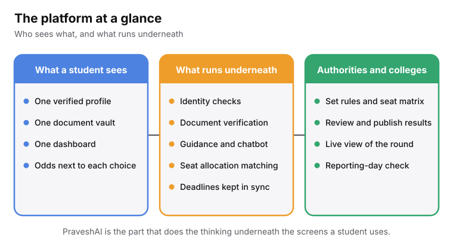
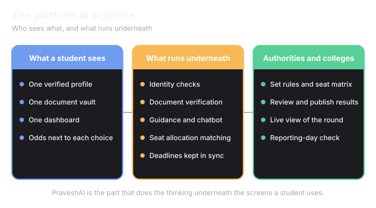

<Frame>
  
  
</Frame>

## The building blocks

<CardGroup cols={2}>
  <Card title="Unified profile and documents" icon="user-check" href="/superadmission/unified-profile-and-documents">
    One verified identity. One document vault. Read by every connected counselling system.
  </Card>
  <Card title="Unified dashboard" icon="layout-dashboard" href="/superadmission/unified-dashboard">
    Deadlines and results from every counselling, in one place.
  </Card>
  <Card title="PraveshAI" icon="cpu" href="/superadmission/praveshai">
    Identity checks, document checks, guidance, seat matching and deadline tracking.
  </Card>
  <Card title="Tools for authorities and colleges" icon="landmark" href="/superadmission/how-counselling-authorities-use-superadmission">
    Run a round, watch it live, and confirm students when they arrive.
  </Card>
</CardGroup>

Continuning our example of Unnati,

She's still eligible for both a JoSAA counselling through her JEE rank and a state counselling through her state CET rank, exactly the situation from the Counselling page. This time, she's doing it with Superadmission.

<Steps>
  <Step title="She creates one profile">
    Unnati verifies her identity through an Aadhaar-linked OTP, the same way she'd log into most government services. Her basic details, name, date of birth, category, are pulled in and confirmed once. This profile is what every counselling system wil see when see connects to them afterwards.
  </Step>
  <Step title="She connects both counsellings she's eligible for">
    She adds JoSAA and her state CET to her profile. Each connection asks for her specific consent, she's agreeing to share her verified information with that particular system, not handing over blanket access to everything.
  </Step>
  <Step title="Her documents get verified once">
    Her Class 12 marksheet and category certificate are fetched from DigiLocker where available. What isn't available there, she uploads once. Everything is checked a single time. Both JoSAA and her state CET see the same "verified" status, neither one re-runs the check independently.
  </Step>
  <Step title="She fills her preferences, with PraveshAI showing her the odds">
    As she builds her list of colleges and branches for both counsellings, PraveshAI shows a probability next to each one, based on her rank, her category, and how similar ranks landed in past years. She still decides the order. Nothing gets added or removed on her behalf.
  </Step>
  <Step title="She locks her list, with one dashboard tracking both deadlines">
    JoSAA's locking window and her state CET's happen to fall two days apart. Her dashboard shows both, sorted by which is closer, with a clear warning since the gap between them is tight enough to be risky if she isn't paying attention.
  </Step>
  <Step title="Both results land on the same screen">
    When allotments are released, she sees her JoSAA result and her state result side by side, instead of logging into two separate portals to piece it together herself.
  </Step>
  <Step title="She accepts one, and gets guided through withdrawing from the other">
    She decides to accept her JoSAA seat. Superadmission walks her through exactly what withdrawing from her state CET seat requires, since forgetting that step is one of the most common ways students accidentally lose deposits or lock themselves out of later rounds.
  </Step>
  <Step title="Reporting day, in person, exactly as before">
    She still shows up to her college physically, with her original documents, the same as any student would. The difference is what happens when she arrives: the institute scans a single code, and her payment, her allotment, and the absence of any duplicate admission elsewhere are all confirmed in seconds, instead of a staff member manually checking each one.
  </Step>
</Steps>
