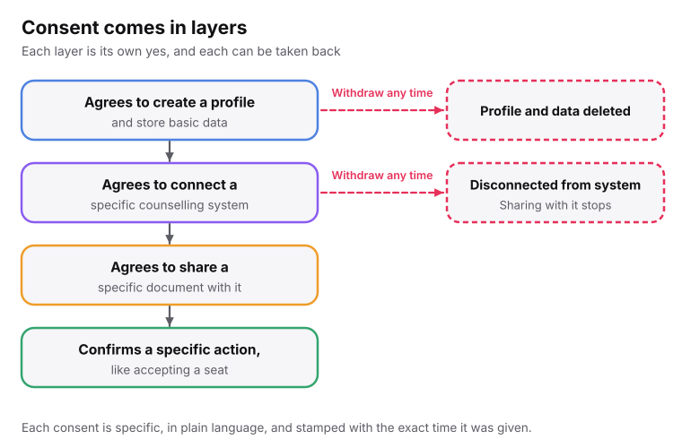
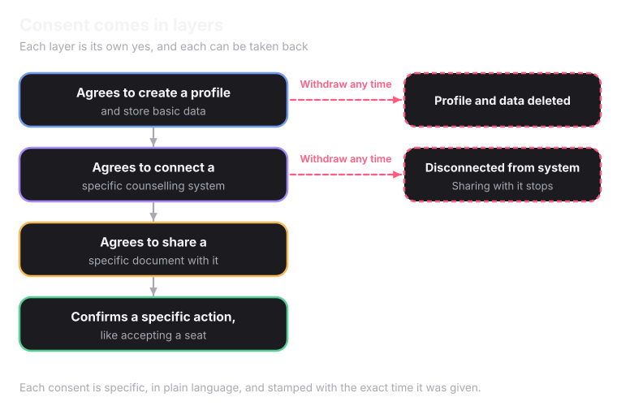

Superadmission holds a student's identity, category, marksheets, rank and seat allotment. This page explains the rules we follow, what the student controls, and how the data is kept safe.

## Two words to know

- **Data fiduciary:** the organisation that decides why and how personal data is used. Superadmission is one.
- **Data principal:** the person the data is about. Here, the student.

## The laws we follow

**The DPDP Act, 2023** is India's main law on personal data. It asks for four things:

- **Proper consent.** A student must say yes before a profile is created, and again before a document is shared with a counselling body. There is no single blanket agreement hidden in the terms.
- **Use only for the reason given.** A category certificate shared for seat allocation cannot be reused for anything else.
- **Collect only what is needed.** If a field is not needed for admission, we do not ask for it.
- **The student's rights.** A student can see their data, correct it, and ask for it to be deleted.

**The IT Act, 2000** makes electronic admission letters legally valid and makes platforms responsible for data breaches.

**The Aadhaar Act, 2016** strictly controls identity checks. Superadmission never stores Aadhaar numbers or biometric data. Verification happens inside UIDAI's own system, and Aadhaar stays optional.

## The student stays in control

A student's data belongs to the student. We use it only in the ways they have agreed to, one consent at a time.

<Frame>
  
  
</Frame>

> Every consent is **available in many Indian languages.** A portal that works only in English is a barrier for many applicants.

The student decides:

- **Which counselling systems to connect.** Connecting JoSAA does not connect a state CET.
- **Which documents to share.** A document verified once is not sent to every system automatically.
- **What to change.** Anything entered can be edited freely until it is locked.
- **When a real action happens.** Nothing that affects a real outcome goes ahead until the student confirms it with their security PIN.

### A student's rights

<AccordionGroup>
  <Accordion title="See everything held about you">
    A student can see all the data held about them and their full history of actions.
  </Accordion>

  <Accordion title="Ask for a correction">
    If something is wrong, the student can ask for it to be fixed.
  </Accordion>

  <Accordion title="Ask for deletion">
    Once a student asks, the data is removed from active systems within 30 days.
  </Accordion>

  <Accordion title="Take a consent back">
    Withdrawing the profile consent deletes the profile and its data. Withdrawing a connection consent disconnects that system and stops sharing with it. Neither affects the other consents.
  </Accordion>
</AccordionGroup>

A grievance officer handles all of these requests within a set time.

## How data is protected

- **Encryption.** All student data is encrypted while it moves and while it is stored.
- **Strict access.**  Only restricted authorities have full access to data, while others have access to only the data that they explicitly require.
- **Extra care for sensitive documents.** Category, domicile and income certificates sit behind stricter controls than a photo or a marksheet. Category data decides which reserved seats a student can get, so it needs the most care.

## Every action leaves a record

Whenever something important happens on Superadmission, such as a document being approved, a list being locked, or a result being published, we save a record of it. The record shows _what happened_, _who or what triggered it_, and _when_. For automated decisions, it also shows why, such as the score a document received or the past-year cutoffs that were used during  recommendation . **_Records can never be edited_**. If something needs correcting, a new record is added and the original stays as it was, so anyone can find out why something happened, even months later.

## Who can see what

| Who | What they can see |
| --- | --- |
| A student | Their own full history: every action on their profile, documents and applications. |
| An authority | Actions within its own counselling process only, not another authority's records. |
| A compliance officer | The full log, when something needs investigating. This is the grievance and data-protection role the DPDP Act requires. |
