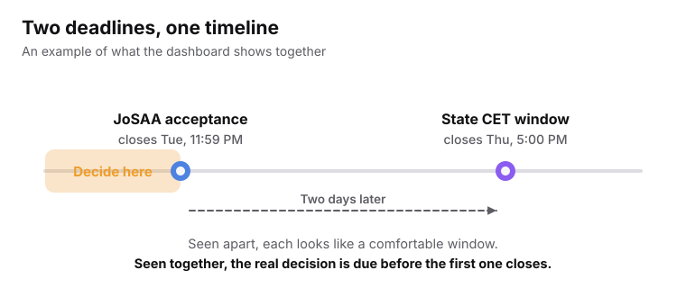
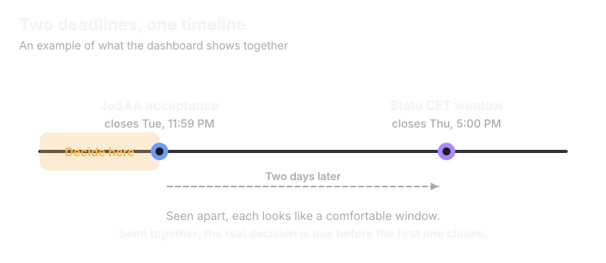

<Info>
Two counselling systems almost never share a calendar. The dashboard puts every deadline a student has in one place, sorted by **urgency**, not by which website it belongs to.
</Info>

## Two deadlines, one timeline

<Frame caption="An example. Each looks comfortable alone. Together they need a decision before the first one closes.">
  
  
</Frame>

## What the dashboard does

<CardGroup cols={2}>
  <Card title="Sorts deadlines by urgency" icon="calendar-clock">
    Across every connected system, with the closest first.
  </Card>
  <Card title="Warns before a clash" icon="triangle-alert">
    If two deadlines sit close enough that missing one is a real risk, it is flagged in advance.
  </Card>
  <Card title="Shows results side by side" icon="columns-2">
    A JoSAA result and a state result appear on one screen.
  </Card>
  <Card title="Explains what accepting means" icon="arrow-left-right">
    If a seat is accepted in one system, the dashboard shows what that means for a seat held in another.
  </Card>
</CardGroup>

## Accepting one, leaving the other

<Steps>
  <Step title="She accepts her JoSAA seat" icon="badge-check">
    She decides which seat she wants.
  </Step>
  <Step title="The dashboard guides her out of the other" icon="log-out">
    Superadmission walks her through exactly what withdrawing from her state CET seat requires.
  </Step>
</Steps>

<Warning>
Forgetting this step is one of the most common ways students lose deposits or lock themselves out of later rounds.
</Warning>

## Alerts

PraveshAI watches every deadline a student is subject to. It sends a direct notification when it matters, for example when a student with no seat yet has a real chance in a CSAB spot round.

See also: [PraveshAI](/superadmission/praveshai) and [Digital Spot Round Environment](/superadmission/digital-spot-round-environment).

<Note>
The dashboard can only be as fresh as the counselling systems it reads from. If a system updates its data once a day, the dashboard cannot show anything newer.
</Note>

<Card title="Next: Counselling and Seat Allocation" icon="shuffle" href="/superadmission/counselling-and-seat-allocation" horizontal>
  How seats get matched.
</Card>
