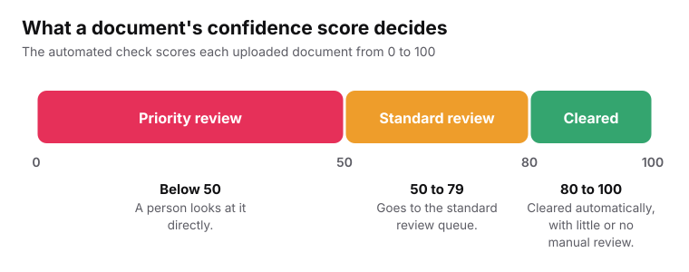
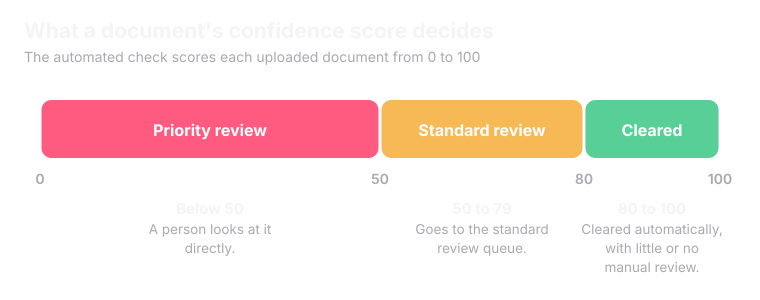

<Info>
A student verifies who they are **once**. Every counselling system they connect afterwards reads from that same profile.
</Info>

## One verified profile

<Steps>
  <Step title="Create profile using Aadhar/APAAR or alternate methods" icon="smartphone">
    The student uses an <Tooltip tip="An Aadhaar-linked OTP is a one-time password sent to the mobile number linked to Aadhaar. Most government services use the same method.">Aadhaar-linked OTP</Tooltip>.This fetches <Tooltip tip="Such as full name, parent's name, date of Birth etc.">basic details</Tooltip> of students.
  </Step>
  <Step title="Fetch/Upload Documents" icon="user-check">
    Documents are then fetched from DigiLocker. For any document that is not available on DigiLocker, the student will later on have the ability to upload them manually.
  </Step>
  <Step title="Set Security PIN" icon="lock">
    The student is asked to create a security PIN. This PIN will be used later on throughout the platform for any decision or action that the student takes, such as locking a preference list, accepting any seat, making a payment, etc. 
  </Step>
  <Step title="Connect only counsellings you choose" icon="link">
    Once the profile creation is completed, the student can connect or add the counseling of their choice with a simple click of a button. They can ask Pravesh AI for assistance to find out which counseling they are eligible for. 
  </Step>
</Steps>

## What a student controls

<CardGroup cols={2}>
  <Card title="Which systems to connect" icon="link">
    Each connection is its own decision.
  </Card>
  <Card title="Which documents to share" icon="files">
    A document verified once is not shared with every system automatically.
  </Card>
  <Card title="Editing before locking" icon="pencil">
    Anything entered can be changed freely until it is locked in.
  </Card>
  <Card title="Confirming real actions" icon="badge-check">
    Nothing that affects a real outcome happens until the student confirms it.
  </Card>
</CardGroup>

<Note>
Each of these can be undone on its own. Support is available in more than one Indian language, because a portal that works only in English is a real barrier for many applicants.
</Note>

See also: [Data Ownership and Consent](/superadmission/data-ownership-and-consent).

## Document vault

A document comes into the vault in one of two ways.

<CardGroup cols={2}>
  <Card title="Fetched from DigiLocker" icon="cloud-download">
    Already signed by the board or university that issued it.
  </Card>
  <Card title="Uploaded by the student" icon="upload">
    Used when the document is not on <Tooltip tip="DigiLocker is the government's digital document locker. Boards and universities place signed, verified copies of certificates there.">DigiLocker</Tooltip> yet. The student uploads it once.
  </Card>
</CardGroup>

An uploaded document is checked automatically for three things.

<CardGroup cols={3}>
  <Card title="Format" icon="file-type">
    Is it the right kind of file?
  </Card>
  <Card title="Completeness" icon="list-checks">
    Is every page there? Is the scan readable?
  </Card>
  <Card title="Consistency" icon="equal">
    Do names match across documents? Are certificate numbers formatted correctly?
  </Card>
</CardGroup>

<Frame caption="The score decides how much human review a document needs.">
  
  
</Frame>

## If a document is rejected

<Accordion title="What the student is told" icon="info">
  The student is told **specifically why**: a mismatch, an unreadable scan or a missing page. Not just the word rejected. A corrected version goes through the same process again.
</Accordion>

<Accordion title="If the student thinks the rejection was wrong" icon="scale">
  That is a dispute. It is handled like any other. See [Managing Admissions](/superadmission/managing-admissions).
</Accordion>

<Tip>
Once a document is verified, that status is **shared, not rechecked**. JoSAA and a state CET see the same verified mark from one check. That is the whole point of doing it once instead of three or four times.
</Tip>

<Card title="Next: Unified Dashboard" icon="layout-dashboard" href="/superadmission/unified-dashboard" horizontal>
  One screen for every deadline and result.
</Card>
