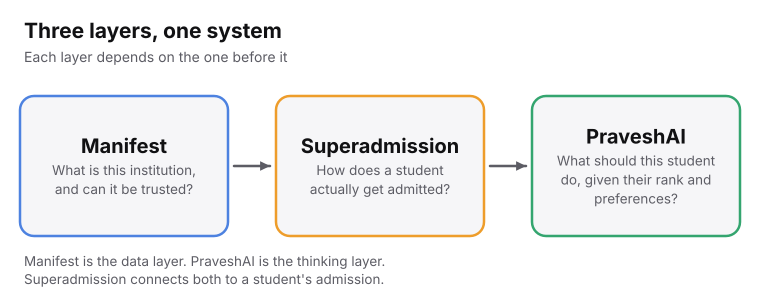
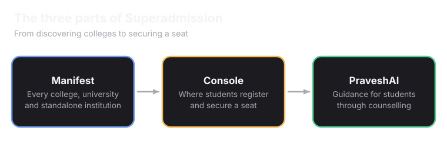
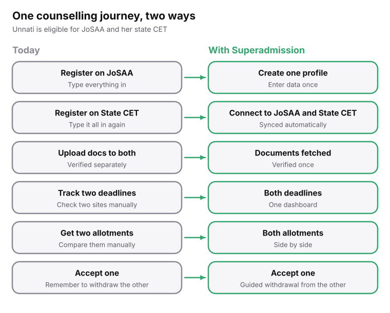
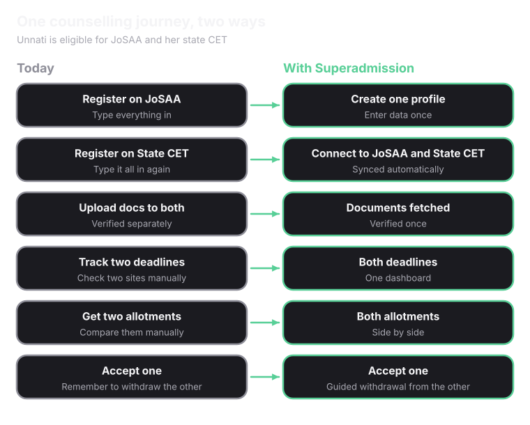

<Info>
Superadmission is a **coordination layer**. It sits above counselling systems like JoSAA and MCC. It does not replace them.
</Info>

## Three parts, one system

<Frame caption="Each layer depends on the one before it.">
  
  
</Frame>

<CardGroup cols={3}>
  <Card title="Manifest" icon="database" href="/superadmission/manifest">
    A registry of India's higher education institutions. It answers one question: can this institution be trusted?
  </Card>
  <Card title="Superadmission" icon="layers" href="/superadmission/the-superadmission-platform">
    The platform a student uses. It answers one question: how does a student actually get admitted?
  </Card>
  <Card title="PraveshAI" icon="cpu" href="/superadmission/praveshai">
    The thinking layer. It answers one question: what should this student do, given their rank and preferences?
  </Card>
</CardGroup>

## One journey, two ways

Unnati is eligible for JoSAA and for her state CET. Here is her journey today, and with Superadmission.

<Frame caption="The same six steps, today and with Superadmission.">
  
  
</Frame>

## What changes for a student

<CardGroup cols={2}>
  <Card title="One profile" icon="user-check" href="/superadmission/unified-profile-and-documents">
    Unnati verifies her identity once through Aadhaar. Every counselling system she connects reads from that one profile.
  </Card>
  <Card title="Documents, once" icon="file-check" href="/superadmission/unified-profile-and-documents">
    A document is fetched once from <Tooltip tip="DigiLocker is the government's digital document locker. Boards and universities place signed, verified copies of certificates there.">DigiLocker</Tooltip>, or uploaded once. It is checked once and reused everywhere.
  </Card>
  <Card title="One dashboard" icon="layout-dashboard" href="/superadmission/unified-dashboard">
    Every counselling's deadlines and results in one place, instead of many websites.
  </Card>
  <Card title="Advice, not decisions" icon="lightbulb" href="/superadmission/praveshai">
    PraveshAI shows her chances next to each choice. She still decides.
  </Card>
</CardGroup>

<Tip>
Aadhaar is optional. A student who does not have Aadhaar, or does not want to use it, can verify another way.
</Tip>

<Note>
Not every document is on DigiLocker yet. Category certificates and domicile proofs still vary by state. Where a document is not there, the student uploads it once.
</Note>

## Who stays in charge

<CardGroup cols={3}>
  <Card title="The authority" icon="landmark">
    Sets the rules, reviews the result and decides when to publish.
  </Card>
  <Card title="A person" icon="user-check">
    Reviews anything that could change whether a student gets a seat.
  </Card>
  <Card title="The student" icon="user">
    Chooses the order of the list and confirms every real action.
  </Card>
</CardGroup>

<Card title="Next: Why India Needs Superadmission" icon="flag" href="/superadmission/why-india-needs-superadmission" horizontal>
  See what goes wrong in admissions today.
</Card>
