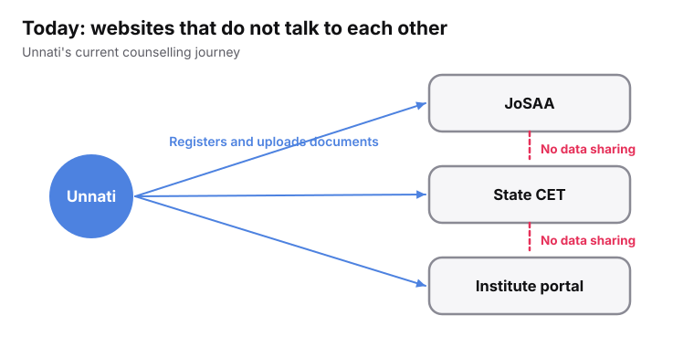
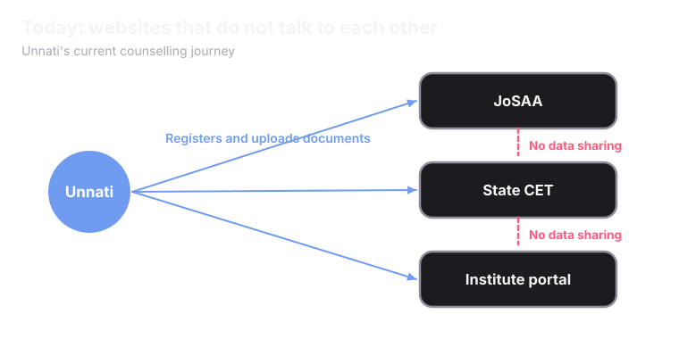

A student  generally uses 2-5 counselling websites at once. 

<Frame caption="Unnati's current counselling journey.">
  
  
</Frame>

## What goes wrong today

<CardGroup cols={2}>
  <Card title="The same details, again" icon="copy">
    A new account and a new form for every counselling system. The same details are typed in each time.
  </Card>
  <Card title="The same documents, again" icon="files">
    One marksheet is uploaded to every portal. Each portal checks it alone, with its own file size limit and its own idea of a valid scan.
  </Card>
  <Card title="Deadlines on different sites" icon="calendar-clock">
    Two counselling systems rarely share a calendar. Two deadlines can land hours apart with nothing connecting them or notifying students.
  </Card>
  <Card title="Two seats, one to give back" icon="arrow-left-right">
    A student with two or more allotments compares them by hand. Then they have to remember to withdraw from the other one within stipulated time.
  </Card>
  <Card title="Notifications displayed through Websites" icon="arrow-left-right">
    All alerts and notifications regarding rounds/allotments etc. are published on individual counselling websites not delivered directly to students.
  </Card>
  <Card title="No Verified Guidance provided to students" icon="arrow-left-right">
    Most students rely on YouTube videos or word-of-mouth advice to make life-altering college decisions. First-generation students face the biggest information barrier, often settling for suboptimal local options despite having high exam scores..
  </Card>
</CardGroup>

<Warning>
Researchers looked at roughly 2,000 real student journeys while building this. A meaningful share of students who started never finished. It was rarely because they were not eligible. It was a missed deadline, a confusing document rejection, or never finding out a seat had opened up in time.
</Warning>

## The size of the problem

<CardGroup cols={3}>
  <Card title="4.50 crore" icon="users">
    students enrolled in higher education (AISHE 2023-24)
  </Card>
  <Card title="59,533" icon="school">
    institutions in the same survey
  </Card>
  <Card title="40+" icon="list-ordered">
    counselling bodies, each with its own site and dates
  </Card>
</CardGroup>

## Who feels it

<CardGroup cols={2}>
  <Card title="Students" icon="graduation-cap">
    

    A first-generation applicant who has no one to explain the process. A student eligible for JEE, NEET and a state CET at once, with three sets of deadlines. A student in a low-connectivity area.
  </Card>
  <Card title="Colleges" icon="school">
    

    They absorb work that has nothing to do with admitting anyone: chasing incomplete records, fixing mismatches, re-checking documents already checked elsewhere.
  </Card>
  <Card title="Counselling authorities" icon="landmark">
    

    The biggest cost is rarely the matching. It is everything around it: checking documents another system already checked, chasing stalled students, answering grievances.
  </Card>
  <Card title="Government and policy" icon="scale">
    

    Two questions matter. Does this fit where education policy is heading? What would approval take?
  </Card>
</CardGroup>

<Accordion title="Finding a trustworthy college is hard too" icon="search">
  Manifest exists because of four problems in how students look up colleges today.

  1. Visibility can be bought, so an advertised college looks better than it is.
  2. Data does not talk to other data, so a student must open many tabs to compare.
  3. Fake or unrecognised institutions are not clearly flagged.
  4. Reservation and seat details are buried in PDFs.

  Read more on the [Manifest](/superadmission/manifest) page.
</Accordion>

<Card title="Next: The Thought Behind Superadmission" icon="lightbulb" href="/superadmission/the-thought-behind-superadmission" horizontal>
  The ideas that shape how it is built.
</Card>
