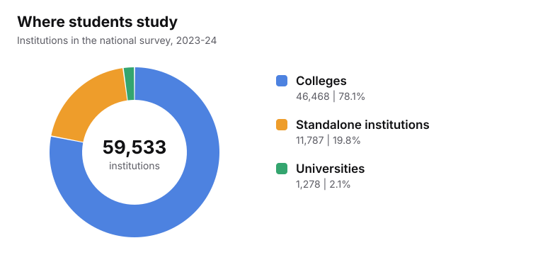
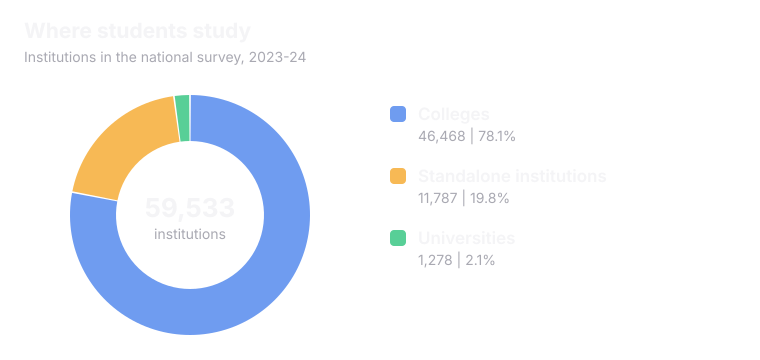

Three kinds of bodies that take part in admissions. Each one has a different job.

<CardGroup cols={3}>
  <Card title="Exam bodies" icon="pencil">
    Run the exam. Give a score and a rank.
  </Card>
  <Card title="Counselling bodies" icon="list-ordered">
    Match ranks to seats.
  </Card>
  <Card title="Colleges" icon="school">
    Teach the students. Give the degree.
  </Card>
</CardGroup>

## Exam bodies

<AccordionGroup>
  <Accordion title="NTA" icon="file-text">
    The National Testing Agency runs JEE Main, NEET UG and CUET UG. It does not run any college. It does not decide who gets a seat.
  </Accordion>
  <Accordion title="The IITs" icon="award">
    One IIT runs JEE Advanced each year, in turns. Students qualify for it through JEE Main.
  </Accordion>
  <Accordion title="State exam bodies" icon="map-pin">
    Many states run their own entrance tests, called CETs, for seats in that state.
  </Accordion>
  <Accordion title="Private universities" icon="briefcase">
    Some private universities run their own entrance tests.
  </Accordion>
</AccordionGroup>

## Counselling bodies

<CardGroup cols={2}>
  <Card title="JoSAA" icon="cpu">
    IITs, NITs, IIITs and other government funded technical institutes. 138 institutes in 2026.
  </Card>
  <Card title="CSAB" icon="refresh-cw">
    Extra rounds for NITs, IIITs and other technical institutes after JoSAA.
  </Card>
  <Card title="MCC" icon="stethoscope">
    Medical Counselling Committee. Many MBBS and BDS seats.
  </Card>
  <Card title="State authorities" icon="map-pin">
    Each state runs counselling for its own seats.
  </Card>
</CardGroup>

<Info>
In all, there are **40+ counselling bodies** in India.
</Info>

## Colleges

India has **59,533 institutions** in the latest national survey (AISHE 2023-24).

<Frame caption="Source: AISHE 2023-24, Ministry of Education. Counts are institutions that responded to the survey.">
  
  
</Frame>

<CardGroup cols={3}>
  <Card title="University" icon="graduation-cap">
    Can give degrees in its own name.
  </Card>
  <Card title="College" icon="school">
    Usually joined to a university. The university gives the degree.
  </Card>
  <Card title="Standalone" icon="building">
    Not a university or a college of one. Examples: polytechnics and nursing schools.
  </Card>
</CardGroup>

## Kinds of institutions you will hear about

<CardGroup cols={2}>
  <Card title="IIT" icon="award">
    Indian Institute of Technology. Top government engineering institutes. 23 take part in JoSAA.
  </Card>
  <Card title="NIT" icon="landmark">
    National Institute of Technology. Government engineering institutes. 31 take part in JoSAA.
  </Card>
  <Card title="IIIT" icon="monitor">
    Indian Institute of Information Technology. Focus on computers and IT. 26 take part in JoSAA.
  </Card>
  <Card title="GFTI" icon="building-2">
    Government Funded Technical Institute. Other technical institutes the government funds. 56 take part in JoSAA in 2026.
  </Card>
  <Card title="Central university" icon="flag">
    Set up by an Act of Parliament and funded by the Central Government. Many use CUET UG.
  </Card>
  <Card title="State university" icon="map-pin">
    Set up by a state law and funded by the state.
  </Card>
  <Card title="Deemed university" icon="badge-check">
    An institution given university status by the Central Government. It keeps its own special focus.
  </Card>
  <Card title="Private university" icon="briefcase">
    Set up by a state law but run by a private body, not by the government.
  </Card>
</CardGroup>

## Who makes the rules?

<CardGroup cols={3}>
  <Card title="UGC" icon="scale">
    University Grants Commission. Looks after universities.
  </Card>
  <Card title="AICTE" icon="cpu">
    All India Council for Technical Education. Looks after technical education.
  </Card>
  <Card title="NMC" icon="stethoscope">
    National Medical Commission. Looks after medical education. It replaced the Medical Council of India in 2020.
  </Card>
</CardGroup>

<Note>
Not every seat is filled through the big counselling bodies. Some colleges fill some seats through their own process.
</Note>

<Card title="Next: Education Policy and Digital India" icon="landmark" href="/understanding-admissions/education-policy-and-digital-india" horizontal>
  See the plans and digital tools behind admissions.
</Card>
