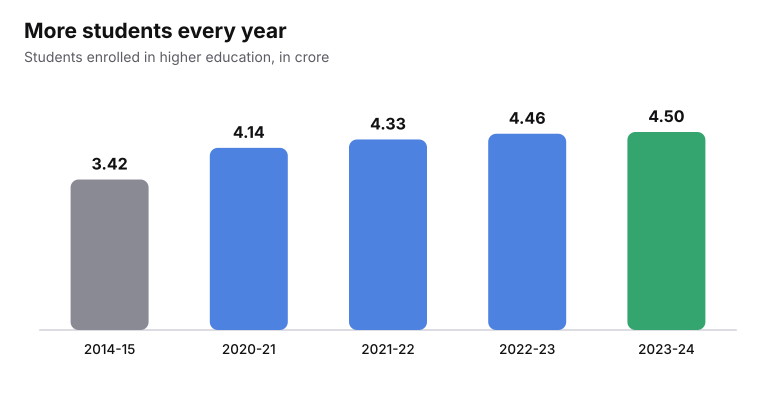
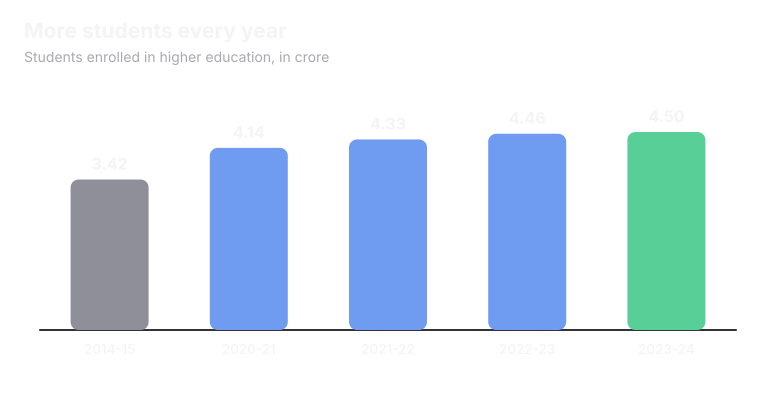
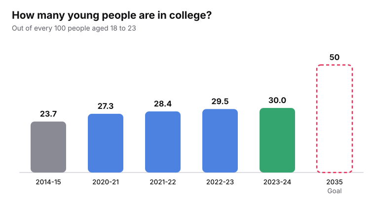
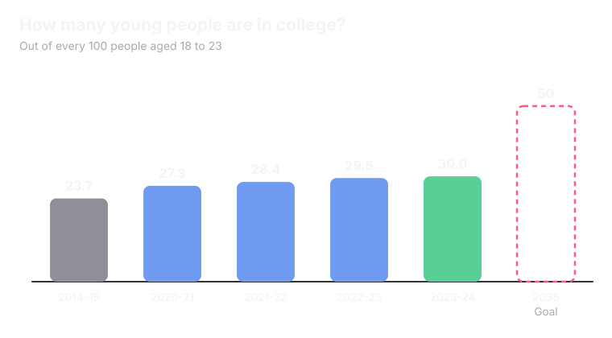
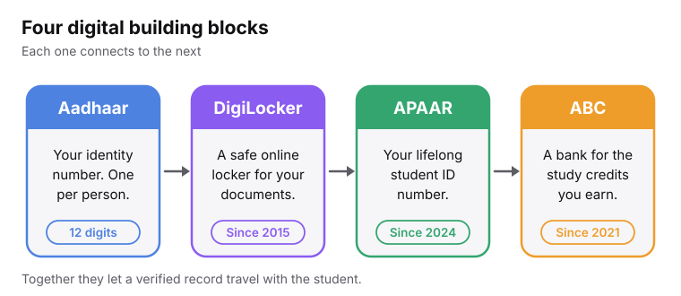
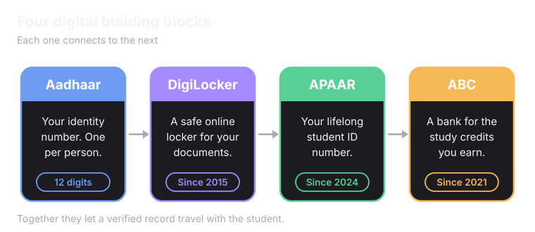

### NEP 2020: The foundation for everything else

The National Education Policy (NEP) was approved on **29 July 2020**. It replaced a policy that was 34 years old.

<CardGroup cols={2}>
  <Card title="Goal: more students in college" icon="target">
    The policy aims for <Tooltip tip="GER means Gross Enrolment Ratio. If 100 young people are aged 18 to 23 and 30 are in college, the GER is about 30.">GER</Tooltip> of 50% by 2035.
  </Card>
  <Card title="Common entrance tests" icon="file-text">
    The policy asks NTA to offer common entrance exams for university admissions. CUET UG started in 2022.
  </Card>
  <Card title="Credits you can carry" icon="bookmark">
    Students can save study credits in the Academic Bank of Credits. It launched on 29 July 2021.
  </Card>
  <Card title="Easier to move between courses" icon="route">
    The policy supports flexible study paths, so a student is not stuck in one track.
  </Card>
</CardGroup>

## How many students are in college?

<Frame caption="Source: AISHE reports, Ministry of Education. 1 crore = 10 million.">
  
  
</Frame>

## How close is India to the goal?

<Frame caption="Source: AISHE reports, Ministry of Education. The dashed bar is the 2035 goal in NEP 2020.">
  
  
</Frame>

<Tip>
Think of it this way. Out of 100 young people aged 18 to 23, about **30** are in college today. The goal is **50**.
</Tip>

## Digital India tools

<Frame caption="These four tools are linked to each other.">
  
  
</Frame>

<AccordionGroup>
  <Accordion title="Aadhaar" icon="fingerprint">
    **Aadhaar is a secure, unique 12-digit identification number issued by the Indian government to its residents.** It uses your fingerprints and iris scans to prove who you are, making it easier other government benefits and tools.
  </Accordion>
  <Accordion title="DigiLocker: Where Verified Documents Live" icon="lock">
    DigiLocker is a digital storage system where official documents, board marksheets, certificates, sometimes Aadhaar itself, are placed directly by the organisation that issued them, digitally signed, and available for the students to share whenever they're asked for.
  </Accordion>
  <Accordion title="APAAR: One ID for a Student's Entire Academic Life" icon="user-check">
    The **Automated Permanent Academic Account Registry**. It gives each student a 12-digit lifelong ID, often called One Nation, One Student ID. It launched on **13 February 2024** and links to Aadhaar, DigiLocker and the Academic Bank of Credits. Think of it as an ID number, similar in spirit to Aadhaar, but built specifically to follow a student's academic record.
  </Accordion>
  <Accordion title="ABC: A Bank Account for Academic Credits" icon="bookmark">
    It works exactly like its name suggests, except what gets deposited isn't money, it's course credits. This is the direct technical answer to NEP's multiple entry and exit promise.

    If a student studies for a semester at one college and later needs to shift to a different one, or takes a certificate course alongside her degree, ABC is meant to store the credits she/he earned along the way in one place, tied to their APAAR ID. Credit earned at one institution doesn't just vanish the moment they're no longer enrolled there. Student can carry it forward, and in principle even redeem it toward a future degree elsewhere.It launched on **29 July 2021**.
  </Accordion>
  <Accordion title="NDEAR: The Core Rules">
    NDEAR stands for National Digital Education Architecture. It isn't a product a student ever directly touches. It's the underlying set of standards that APAAR, ABC, DigiLocker, and other education systems all agree to follow, so they can exchange information with each other without every single pair of systems needing a custom-built connection between them.

    > A useful way to think about it: NDEAR is the agreed shape of the pipes. APAAR, ABC, and DigiLocker are what flows through those pipes.
  </Accordion>
</AccordionGroup>

  

  

    ### DPDP: Digital Personal Data Protection Act, 2023
  

DPDP sets out a few plain obligations for anyone handling personal data, including Unnati's rank, category, documents, and contact details as they move through counselling:

- **Consent is required**, and has to be specific, not buried in fine print she never reads.
- **Data can only be used for the purpose it was collected for.** A counselling body collecting her category for seat allocation cannot repurpose it for something unrelated without asking again.
- **She has a right to correction and erasure.** If something about her stored data is wrong, or she wants it removed once it's no longer needed, the law gives her a route to ask for that.

Any system proposing to move a student's data between counselling bodies, DigiLocker, and APAAR, the way Superadmission proposes to, has to be built around these obligations.

  

  

    ### The IndiaAI Mission:
  

The IndiaAI Mission is the government's national program for building out India's AI capability, compute infrastructure, shared datasets, skilling, and a specific focus area called Safe and Trusted AI, which is about making sure AI systems used in important decisions are explainable and don't behave like an unaccountable <Tooltip tip="Add tooltip text">black box</Tooltip>.

This applies directly to PraveshAI, the reasoning and guidance engine inside Superadmission. A seat allocation decision affects a student's entire future, so using an unexplainable "black box" AI is a major problem. PraveshAI is built so its logic can be inspected and reasoned, matching exactly what the "Safe and Trusted AI" pillar of the IndiaAI Mission asks for.

<Tip>
Verified digital records can take the place of paper copies. That can save students time at every step.
</Tip>

<Card title="Next: Global Perspective" icon="globe" href="/understanding-admissions/global-perspective" horizontal>
  See how other countries run admissions.
</Card>
