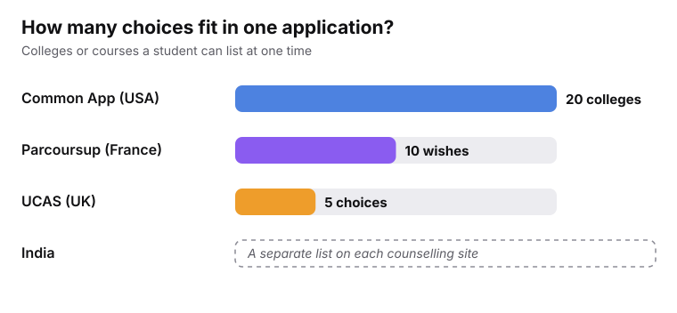
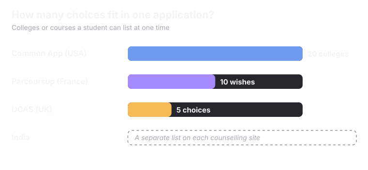
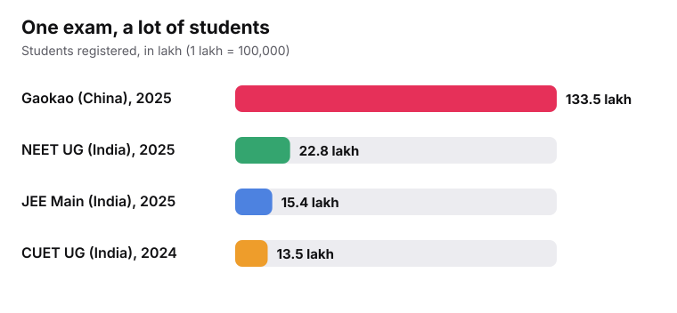
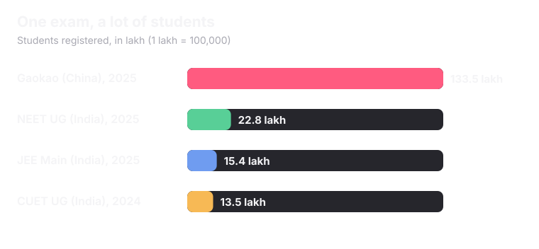

<Info>
Every country runs admissions in its own way. Looking at a few helps us see what is special about India.
</Info>

## Four ways to do it

<CardGroup cols={2}>
  <Card title="USA: Common App" icon="flag">
    One online form can go to many colleges. A student can have up to **20** colleges on it at one time. Each college decides on its own.
  </Card>
  <Card title="UK: UCAS" icon="flag">
    One form for almost all undergraduate places. A student gets up to **5** choices. Each university decides and sends its own offer.
  </Card>
  <Card title="France: Parcoursup" icon="flag">
    A national website run by the government. A student sends up to **10** wishes. The wishes are not ranked. Close to 980,000 candidates registered in 2025.
  </Card>
  <Card title="China: Gaokao" icon="flag">
    One national exam every June. About **13.35 million** students registered in 2025. The exam score plays the biggest part.
  </Card>
</CardGroup>

## How many choices fit in one application?

<Frame caption="Sources: Common App, UCAS and Parcoursup.">
  
  
</Frame>

<Tip>
In the USA, the UK and France, a student starts at **one platform**. In India, there is one front door for each counselling body.
</Tip>

## How big are the exams?

<Frame caption="Sources: China's Ministry of Education, NTA. 1 lakh = 100,000. Registered students, not those who appeared.">
  
  
</Frame>

<Info>
The Gaokao is one exam for the whole country. India has **150+** exams, so no single exam is as big. India's three biggest exams together are still smaller than the Gaokao.
</Info>

## And in India?

<CardGroup cols={3}>
  <Card title="Many exams" icon="file-text">
    India runs over 150 national and state exams.
  </Card>
  <Card title="Many counselling bodies" icon="users">
    There are 40+ of them. Each has its own site and dates.
  </Card>
  <Card title="Many colleges" icon="school">
    59,533 institutions took part in the latest national survey.
  </Card>
</CardGroup>

<Note>
Numbers for other countries come from their own education bodies and may be counted in different ways. Compare them for the big picture, not for exact differences.
</Note>

<Card title="Next: Glossary" icon="book-open" href="/understanding-admissions/glossary" horizontal>
  Short meanings for every term in these pages.
</Card>
