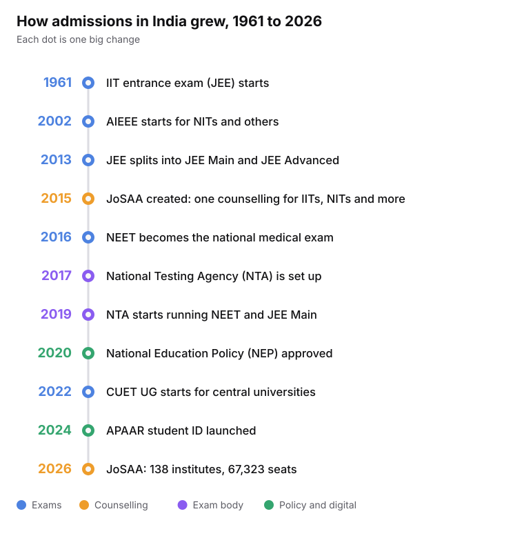

## The timeline of admissions

<Frame caption="Sources: IITs, CBSE, NTA, JoSAA and the Ministry of Education.">
  
  
</Frame>

## 4 big changes that help evolve the admission ecosystem of India

<CardGroup cols={2}>
  <Card title="Common entrance exams " icon="file-check">
    Common national tests like JEE Main, NEET and CUET UG now do the job of many separate tests.
  </Card>
  <Card title="One body to run the tests" icon="building-2">
    The National Testing Agency (NTA) was set up in 2017. Before that, CBSE ran JEE Main and NEET.
  </Card>
  <Card title="One counselling for multiple colleges" icon="users">
    Various different counselling bodies were setup for counselling for multiple colleges ( like Josaa or MCA) 
  </Card>
  <Card title="Digital records" icon="fingerprint">
    DigiLocker came in 2015, the Academic Bank of Credits in 2021, and the APAAR student ID in 2024 to hold govt. issued documents.
  </Card>
</CardGroup>

## The numbers grew too

<CardGroup cols={3}>
  <Card title="16,04,854 unique candidates" icon="users">
    registered for the JEE main 2026 exam, significant growth from the 12.82 lakh that registered for <Tooltip tip="JEE Main was introduced in 2013 (replacing the AIEEE)">JEE main 2013</Tooltip>. 
  </Card>
  <Card title="14.77 lakh" icon="users">
    registered for JEE Main in 2024
  </Card>
  <Card title="15.40 lakh" icon="users">
    registered for JEE Main in 2025
  </Card>
</CardGroup>

<Tip>
Across all higher education, enrolment grew **31.5%** between 2014-15 and 2023-24. That is from 3.42 crore to 4.50 crore students.

**The National Education Policy (NEP) 2020 aims to double India's Higher Education Gross Enrolment Ratio (GER) from 26.3% to 50% by the year 2035**. This historic expansion intends to add **3.5 crore new seats**, effectively scaling total student enrolment from roughly 3.5 crore to approximately 7 crore nationwide.
</Tip>

<Card title="Next: Admission Systems and Institutions" icon="school" href="/understanding-admissions/admission-systems-and-institutions" horizontal>
  Meet the players in the system.
</Card>
