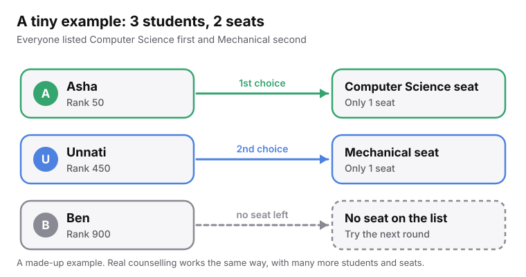
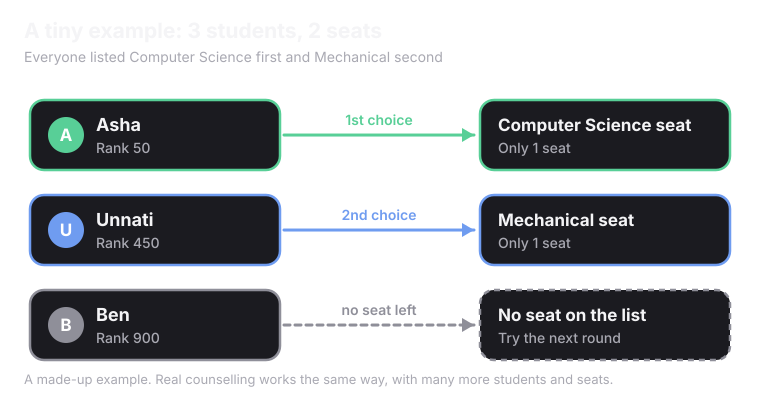
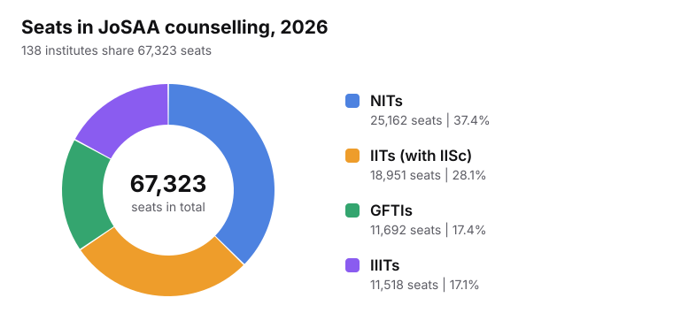
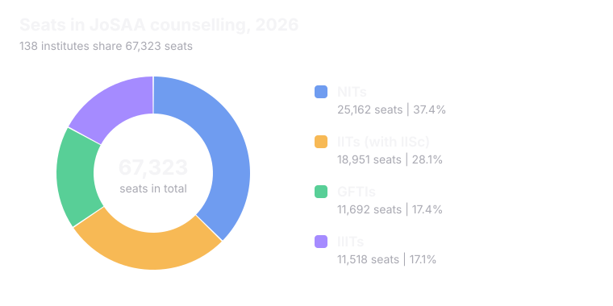
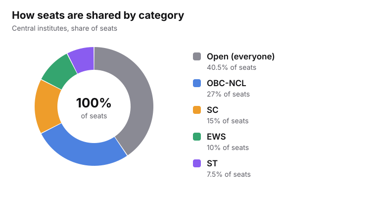
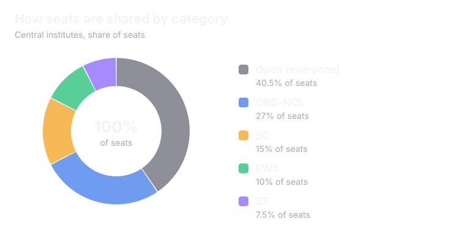

<Info>
In this page, **counselling has nothing to do with therapy**. It is the process that turns a <Tooltip tip="A rank is a position in a line. Rank 1 is the best.">rank</Tooltip> into a seat in a college.
</Info>

## Counselling in 3 ideas

<CardGroup cols={3}>
  <Card title="You wish" icon="list-ordered">
    You list the colleges and courses you want, from most wanted to least wanted.
  </Card>
  <Card title="Rank decides" icon="trophy">
    A computer checks every student's rank and how many seats each college has.
  </Card>
  <Card title="You get one seat" icon="badge-check">
    Each student is matched to one seat, if a match is possible.
  </Card>
</CardGroup>

## Try it: 3 students, 2 seats

<Frame caption="A made-up example to show the idea.">
  
  
</Frame>

<Tip>
A smaller rank number is better. Rank 50 goes before rank 450.
</Tip>

<Accordion title="How did the computer decide?" icon="lightbulb">
  1. Asha has the best rank. She goes first and gets her first choice.
  2. Unnati is next. Computer Science is gone, so she gets her second choice, Mechanical.
  3. Ben is last. Both seats are taken. He tries again in the next round.
</Accordion>

<Note>
For the curious: JoSAA's matching rule is a version of the Gale-Shapley <Tooltip tip="Deferred acceptance means offers are held, not final, until the round ends. A better offer can replace a weaker one.">deferred acceptance</Tooltip> method.
</Note>

## The 6 steps

<Steps>
  <Step title="Register" icon="user-plus">
    Sign up on the counselling website. Fill in your exam details.
  </Step>
  <Step title="Fill your choices" icon="list-ordered">
    List colleges and courses in order. Your favourite goes on top.
  </Step>
  <Step title="Lock your list" icon="lock">
    Lock the list before the deadline. After that, you cannot change it for that round.
  </Step>
  <Step title="See your seat" icon="trophy">
    The computer matches ranks to seats. The result is called an <Tooltip tip="Allotment means the seat the computer has offered you.">allotment</Tooltip>.
  </Step>
  <Step title="Decide" icon="badge-check">
    Accept the seat and pay the seat fee. If you do not accept, the seat is released.
  </Step>
  <Step title="Report" icon="building-2">
    Go to the college with your documents before the deadline. Some counselling bodies let you do part of this online.
  </Step>
</Steps>

<Warning>
Deadlines are strict. If you miss one, the seat can go to someone else.
</Warning>

## Why more than one round?

Not everyone accepts the seat they are offered. Those seats become free and are offered again in the next round.

<Info>
JoSAA ran **six rounds** in 2025.
</Info>

When you accept a seat, you can often pick one of three options. These names are used by JoSAA. Other counselling bodies may use different words.

<CardGroup cols={3}>
  <Card title="Freeze" icon="lock">
    "I love this seat. Lock it in." You stop looking for a better one.
  </Card>
  <Card title="Float" icon="arrow-up">
    "Keep this seat for now. Move me up if a better college on my list opens up."
  </Card>
  <Card title="Slide" icon="arrow-right">
    "Keep this college. Move me to a better course in the same college if one opens up."
  </Card>
</CardGroup>

## What is being matched?

Just one counselling body, JoSAA, gives out **67,323 seats** in 2026.

<Frame caption="Source: JoSAA 2026 seat matrix. GFTIs are Government Funded Technical Institutes.">
  
  
</Frame>

Seats are also shared by category. By rule, some seats are kept for <Tooltip tip="SC means Scheduled Castes. ST means Scheduled Tribes. OBC-NCL means Other Backward Classes (non-creamy layer). EWS means Economically Weaker Sections.">certain groups</Tooltip>. Students in these groups also get a <Tooltip tip="A category rank is your position among students of the same category.">category rank</Tooltip>.

<Frame caption="Central reservation rules as followed in JoSAA. Seats for persons with disabilities (5%) are counted inside each group.">
  
  
</Frame>

<Tip>
In NITs, half the seats go to students from the college's own state (<Tooltip tip="Home State means the state where the college is located.">Home State</Tooltip>). The other half go to students from other states.
</Tip>

## Who runs counselling?

There is no single body for the whole country.

<CardGroup cols={2}>
  <Card title="JoSAA" icon="cpu">
    Counselling for IITs, NITs, IIITs and other government funded technical institutes. 138 institutes in 2026.
  </Card>
  <Card title="CSAB" icon="refresh-cw">
    Runs extra rounds for NITs, IIITs and other technical institutes after JoSAA ends.
  </Card>
  <Card title="MCC" icon="stethoscope">
    The Medical Counselling Committee runs counselling for many MBBS and BDS seats across India.
  </Card>
  <Card title="State authorities" icon="map-pin">
    Each state runs counselling for its own seats. These are separate from JoSAA and MCC.
  </Card>
</CardGroup>

<Info>
There are **40+ counselling bodies** in India. Each has its own website, dates and rules.
</Info>

<Card title="Next: The History of Admissions in India" icon="history" href="/understanding-admissions/history-of-admissions-in-india" horizontal>
  See how all of this came to be.
</Card>
